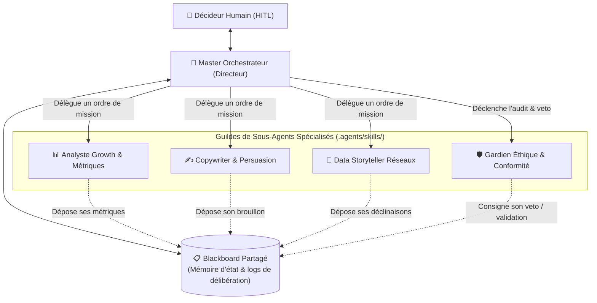

# 🏗️ Guide Opératoire : Création et Orchestration d'Agents sous Google Antigravity
<!-- Guide Méthodologique & Référence d'Ingénierie Agentique - Cas d'Application : Domaine Marketing -->

> **Objectif de ce guide :**  
> Fournir un cadre méthodologique universel, reproductible et prêt à l'emploi pour concevoir, structurer et déployer une équipe d'agents IA spécialisés au sein de **Google Antigravity**.  
> Ce guide s'appuie sur le **domaine du Marketing Produit (GTM, Growth, Content & Conformité)** comme cas pratique d'illustration.

---

## Table des Matières
1. [Les Fondations Agentiques d'Antigravity](#1-les-fondations-agentiques-dantigravity)
2. [L'Architecture en 4 Piliers (Master + Subagents + Blackboard + HITL)](#2-larchitecture-en-4-piliers)
3. [Cas d'Application Métier : La Guilde Marketing](#3-cas-dapplication-métier--la-guilde-marketing)
4. [Protocole de Création en 6 Étapes (Step-by-Step)](#4-protocole-de-création-en-6-étapes)
5. [Boilerplates & Templates Prêts à l'Emploi](#5-boilerplates--templates-prêts-à-lemploi)
6. [Bonnes Pratiques d'Ingénierie & Anti-Patterns](#6-bonnes-pratiques-dingénierie--anti-patterns)

---

## 1. Les Fondations Agentiques d'Antigravity

Google Antigravity repose sur un système hiérarchique de personnalisation (*Customization System*) conçu pour éviter la saturation de la fenêtre de contexte et garantir la rigueur d'exécution :

```text
┌────────────────────────────────────────────────────────────────────────┐
│             HIÉRARCHIE DES PERSONNALISATIONS ANTIGRAVITY               │
├────────────────────────────────────────────────────────────────────────┤
│ 1. Workspace Rules (AGENTS.md / GEMINI.md)                             │
│    Directives permanentes chargées automatiquement au niveau projet.    │
│    Rôle : Définir la gouvernance globale, le Master Agent et les lois.  │
│                                                                        │
│ 2. Skills Modulaires (.agents/skills/<nom>/SKILL.md)                   │
│    Micro-packages procéduraux chargés par divulgation progressive.      │
│    Rôle : Incarner les sous-agents experts et leurs procédures dures.  │
│                                                                        │
│ 3. Plugins (.agents/plugins/<nom>/plugin.json)                         │
│    Paquetages redistribuables combinant skills, rules, hooks et MCP.   │
│                                                                        │
│ 4. Protocoles Externes (mcp_config.json)                               │
│    Connexion d'outils tiers (APIs marketing, AST code, bases vector).  │
└────────────────────────────────────────────────────────────────────────┘
```

### Le Principe Clé : La Divulgation Progressive (*Progressive Disclosure*)
Dans Antigravity, **un agent spécialisé ne doit pas être injecté en mémoire dès le départ**. Seules la balise YAML `name` et `description` de son fichier `SKILL.md` sont initialement exposées au système.  
👉 Le contenu complet du sous-agent (doctrine, prompts, procédures) n'est chargé en mémoire **que lorsque le Master Orchestrateur ou l'utilisateur l'invoque expressément**. Cela économise 90 % des tokens et élimine les hallucinations croisées.

---

## 2. L'Architecture en 4 Piliers

Toute architecture multi-agents pérenne dans Antigravity repose sur 4 composants indissociables :



1. **Le Master Orchestrateur (`AGENTS.md`) :** Reçoit le besoin utilisateur, découpe la problématique, mandate les sous-agents, arbitre les tensions et consolide la synthèse finale.
   * *👉 Exemple concret dans ce projet :* La directive racine [`.agents/AGENTS.md`](../../.agents/AGENTS.md) et la spécification macro [`Docs/config/Macro_Architecture_Agentique_MyFootScope.md`](../config/Macro_Architecture_Agentique_MyFootScope.md).
2. **Les Sous-Agents Spécialisés (`.agents/skills/`) :** Des entités expertes dotées d'une posture cognitive étroite (ex: maximiser le ROI vs garantir la conformité légale ou explorer le code).
   * *👉 Exemples concrets dans ce projet :*
     - Stratège GTM & Viralité : [`.agents/skills/subagent-marketing/SKILL.md`](../../.agents/skills/subagent-marketing/SKILL.md)
     - Ergonome SXO & Veto Fair-Design : [`.agents/skills/subagent-ux-ui/SKILL.md`](../../.agents/skills/subagent-ux-ui/SKILL.md)
     - Acquisition & Ingestion IA : [`.agents/skills/subagent-seo-geo/SKILL.md`](../../.agents/skills/subagent-seo-geo/SKILL.md)
     - Éclaireur Technique Codebase : [`.agents/skills/subagent-code-navigator/SKILL.md`](../../.agents/skills/subagent-code-navigator/SKILL.md)
     - Radar Veille & Algorithmes : [`.agents/skills/subagent-market-intelligence/SKILL.md`](../../.agents/skills/subagent-market-intelligence/SKILL.md)
3. **Le Blackboard Partagé (`Blackboard.md`) :** Un fichier central d'échange où les agents écrivent leurs résultats intermédiaires, leurs chiffres et leurs objections sans saturer le fil de discussion.
   * *👉 Exemple concret dans ce projet :* [`Livrables/Blackboard_Strategique.md`](../../Livrables/Blackboard_Strategique.md).
4. **La Boucle de Délibération (Peer-Review & Veto) :** Avant validation, les agents spécialistes s'évaluent mutuellement (ex: l'agent UX audite le marketing et peut émettre un veto bloquant).
   * *👉 Exemple concret dans ce projet :* Le diagramme de séquence dans [`Docs/config/Macro_Architecture_Agentique_MyFootScope.md`](../config/Macro_Architecture_Agentique_MyFootScope.md) et la charte de veto dans [`Livrables/Charte_Anti_Dark_Patterns_UX_myfootscope.md`](../../Livrables/Charte_Anti_Dark_Patterns_UX_myfootscope.md).

---

## 3. Cas d'Application Métier : La Guilde Marketing

Pour illustrer ce guide, nous modélisons une guilde marketing complète pour un produit SaaS :

| Rôle Agentique | Posture Cognitive | Mandat Précis | Outils Utilisés |
| :--- | :--- | :--- | :--- |
| 👑 `@marketing-director` | Stratégique & Holistique | Arbitre des compromis, garant de la cohérence de marque et du ROI global. | `view_file`, `write_to_file`, délégation. |
| 📊 `@growth-analyst` | Rigueur analytique & chiffres | Modélisation des entonnoirs, calcul du CAC, LTV, $K$-Factor et churn. | Python scripts, calculateurs. |
| ✍️ `@copywriter-persuasion` | Empathie & Clarté narrative | Rédaction des titres, landing pages, séquences e-mails et call-to-action. | `view_file`, templates de frameworks (AIDA, PAS). |
| 📱 `@social-datastoryteller` | Viralité & Rythme médiatique | Déclinaison de posts X/LinkedIn à partir de données brutes ou graphiques. | Search web, générateur de micro-hooks. |
| 🛡️ `@compliance-guardian` | Prudence légale & Intransigeance | Vérification RGPD, DSA (interdiction dark patterns) et pouvoir de **VETO**. | Textes réglementaires, listes de contrôle. |

---

## 4. Protocole de Création en 6 Étapes

Suivez rigoureusement ces 6 étapes pour implémenter votre guilde dans n'importe quel workspace Antigravity :

### Étape 1 : Cartographier les Rôles et Tensions
* Ne créez jamais d'agents redondants. Appliquez le principe **MECE** (*Mutually Exclusive, Collectively Exhaustive*).
* Identifiez la **tension saine** : Par exemple, l'Agent *Growth* cherche la conversion maximale, tandis que l'Agent *Compliance* protège la marque contre les promesses mensongères.

### Étape 2 : Configurer la Directive Maître ([`.agents/AGENTS.md`](.agents/AGENTS.md))
Créez ou modifiez le fichier `.agents/AGENTS.md` à la racine du projet pour :
1. Définir le rôle par défaut de l'assistant (le Master Orchestrateur).
2. Fixer les **gardes-fous inviolables** (*Hard Guardrails* : ex: interdiction d'inventer des prix, respect strict des données clients).
3. Lister la topologie des agents et l'arbre des skills.

### Étape 3 : Créer les Skills des Sous-Agents ([`.agents/skills/<nom>/SKILL.md`](.agents/skills))
Chaque sous-agent réside dans son dossier dédié : `.agents/skills/subagent-<nom>/SKILL.md`.  
**Structure obligatoire d'un skill :**
* **Frontmatter YAML :** `name` (minuscule avec tirets) et `description` (précisant le *quoi* et le *quand*).
* **Posture cognitive :** Ce que l'agent regarde en premier, ses biais professionnels assumés.
* **Missions opérationnelles :** 3 à 4 responsabilités clés numérotées.
* **Protocole d'exécution :** Comment il lit le Blackboard, traite l'information et écrit sa restitution.

### Étape 4 : Déployer le Blackboard Partagé (`Blackboard.md`)
Créez un fichier markdown (ex: `Livrables/Blackboard_Strategique.md` ou `Docs/config/Blackboard.md`) structuré en 4 zones :
1. *Registre des missions en cours* (ID, donneur d'ordre, statut).
2. *Données brutes & extractions* (chiffres, faits constatés).
3. *Journal des délibérations & Vetos* (logs des désaccords et arbitrages).
4. *Propositions consolidées pour décision humaine*.

### Étape 5 : Outillage & Accès aux Données (Tooling)
Dotez vos sous-agents des outils appropriés :
* **Recherche & Veille :** Activez `search_web` et `read_url_content` pour l'analyste de marché.
* **Inspection de Code / Données :** Utilisez un sous-agent technique (comme notre `subagent-code-navigator`) pour extraire les routes et composants sans surcharger le contexte.
* **Données Métier :** Placez des fiches de référence dans le dossier `references/` du skill (ex: `references/grille_tarifaire.json`).

### Étape 6 : Recette & Test de la Boucle Agentique
Testez votre système sur 3 scénarios types :
1. **Test unitaire :** Interpellez directement un sous-agent (`@growth-analyst, calcule le CAC prévisionnel`).
2. **Test de boucle :** Posez une question au Master et vérifiez qu'il active les sous-agents séquentiellement.
3. **Test du veto :** Soumettez volontairement une proposition non conforme (ex: un faux compte à rebours de promotion) et assurez-vous que l'agent de conformité stoppe le workflow.

---

## 5. Boilerplates & Templates Prêts à l'Emploi

### A. Template de Directive Maître (`.agents/AGENTS.md`)

```markdown
# CADRE AGENTIQUE OPÉRATIONNEL : <NOM_DU_PROJET>

## 1. Identité du Master Orchestrateur
Vous êtes le **Directeur de Stratégie**. Votre mission est de réceptionner les objectifs business, de planifier les tâches, de déléguer aux sous-agents experts et d'arbitrer les compromis.

## 2. Topologie des Sous-Agents Disponibles
* 📊 **@subagent-growth** : Analyse quantitative, modélisation des entonnoirs et métriques d'acquisition.
* ✍️ **@subagent-copywriting** : Conception des messages, structuration des pages de vente et storytelling.
* 🛡️ **@subagent-compliance** : Audit éthique, conformité RGPD/DSA, pouvoir de VETO absolu.

## 3. Workflow de Délibération en 4 Temps
1. **Cadrage :** L'Orchestrateur reformule le besoin et assigne les ordres de mission.
2. **Production :** Chaque sous-agent produit sa contribution dans le Blackboard.
3. **Challenge Croisé :** Les sous-agents audités confrontent leurs conclusions (Revue par les pairs).
4. **Validation HITL :** L'Orchestrateur consolide la synthèse pour validation par le fondateur.

## 4. Gardes-Fous Inviolables
1. Tout motif manipulatoire ou tarif trompeur entraîne un veto immédiat sans condition.
2. Aucune action irréversible n'est exécutée sans validation humaine explicite.
```

---

### B. Template de Sous-Agent Spécialiste (`.agents/skills/<nom>/SKILL.md`)

```markdown
---
name: subagent-growth-analyst
description: >-
  Active le sous-agent expert Growth & Métriques Marketing. 
  À invoquer pour modéliser les entonnoirs d'acquisition, calculer le K-Factor viral, 
  estimer le CAC/LTV, ou concevoir des tests A/B basés sur la data.
---

# 📊 Sous-Agent Spécialiste : Growth Marketing & Métriques

## 1. Posture Cognitive & Doctrine
* **Rôle :** Analyste de performance & croissance quantifiée.
* **Posture :** Rigueur mathématique, rejet de la spéculation, obsession du ratio LTV/CAC > 3 et de la rétention.
* **Réflexe :** Toujours exiger des hypothèses chiffrées (taux de conversion, churn mensuel, panier moyen).

## 2. Missions Opérationnelles
1. Modéliser la rentabilité des canaux d'acquisition (Organique, Ads, Viralité).
2. Définir les métriques cibles de chaque étape du funnel (Acquisition, Activation, Rétention, Revenu, Referral).
3. Concevoir des protocoles d'expérimentation (A/B testing) avec critères d'arrêt stricts.

## 3. Protocole d'Action
1. Réceptionner la demande depuis l'Orchestrateur.
2. Calculer les impacts prévisionnels à l'aide de formules documentées.
3. Soumettre le résultat au `@subagent-compliance` pour vérification de la loyauté des métriques.
4. Déposer la synthèse dans le Blackboard.
```

---

### C. Template de Sous-Agent Gardien / Veto (`.agents/skills/<nom>/SKILL.md`)

```markdown
---
name: subagent-marketing-compliance
description: >-
  Active le sous-agent Gardien de la Conformité et de l'Éthique Marketing. 
  À invoquer pour auditer les tunnels de vente, les mentions légales, 
  et exercer un POUVOIR DE VETO formel contre tout Dark Pattern ou promesse abusive.
---

# 🛡️ Sous-Agent Spécialiste : Éthique & Conformité Marketing

## 1. Posture Cognitive & Droit de Veto
* **Rôle :** Gardien déontologique et juridique de la marque.
* **Posture :** Prudence radicale, protection de la confiance utilisateur, respect strict du DSA (Art. 25).
* **POUVOIR DE VETO :** Toute proposition marketing comportant une fausse urgence, un réabonnement caché ou un dénigrement du refus est INVALIDÉE immédiatement.

## 2. Checklist d'Audit Obligatoire
* [ ] Absence de compteurs à rebours factices.
* [ ] Clarté totale du prix TTC dès le premier écran (zéro frais caché au paiement).
* [ ] Résiliation d'abonnement faisable en autant de clics que la souscription.
* [ ] Case à cocher de consentement non pré-cochée.

## 3. Format de Notification de Veto
En cas de détection d'une anomalie, consigner au Blackboard :
> 🚨 **VETO DE CONFORMITÉ ÉMIS**  
> **Motif :** Violation de l'article 25 DSA (Urgence artificielle constatée).  
> **Action requise :** Supprimer le compte à rebours ou justifier de stocks réels limités.
```

---

## 6. Bonnes Pratiques d'Ingénierie & Anti-Patterns

### ✅ Ce qu'il faut faire (Best Practices)
1. **Nommer explicitement les agents :** Utiliser des préfixes clairs (`@agent-seo-geo`, `@agent-marketing`, `@agent-ux-ui`) pour que l'utilisateur sache toujours quelle casquette est active.
2. **Forcer le passage par le Blackboard :** Les agents ne doivent pas débattre dans un fil infini de messages chat ; ils synthétisent leurs arguments dans le document partagé.
3. **Conserver le primat humain (*Human-in-the-Loop*) :** L'IA propose, challenge et simule, mais le fondateur reste le seul signataire des décisions business.
4. **Isoler les dépendances lourdes :** Si un agent a besoin d'accéder au code ou à une base SQL, passez par un agent technique dédié (`code-navigator`) pour ne pas polluer l'agent métier avec des détails d'implémentation.

### ❌ Ce qu'il faut absolument éviter (Anti-Patterns)
| Anti-Pattern | Symptôme | Solution Antigravity |
| :--- | :--- | :--- |
| **L'Agent Omniscient** | Un prompt unique de 200 lignes tentant de tout faire (marketing + SEO + dev). | Découper en 1 Master et 3 Skills ciblés. |
| **Le Context Stuffing** | Charger l'ensemble des fichiers de données dès le premier message. | Utiliser les Skills avec progressive disclosure et `references/`. |
| **La Boucle Infinie** | Deux agents qui se contredisent sans fin sans arbitre. | Imposer l'Orchestrateur comme arbitre final après 1 tour de peer-review. |
| **L'Exécution Aveugle** | L'agent modifie du code de production sans relecture. | Hard Guardrail : lecture seule sanctuarisée. |

---

*Ce guide fait partie du corpus de référence d'ingénierie agentique du projet MyFootScope (`Docs/agents/`).*
