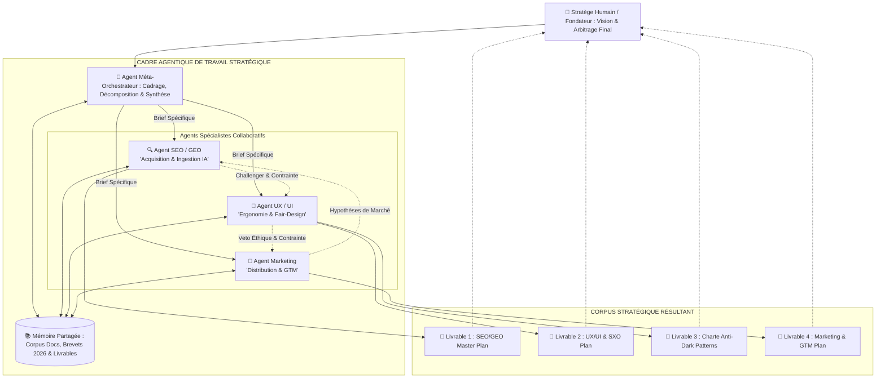
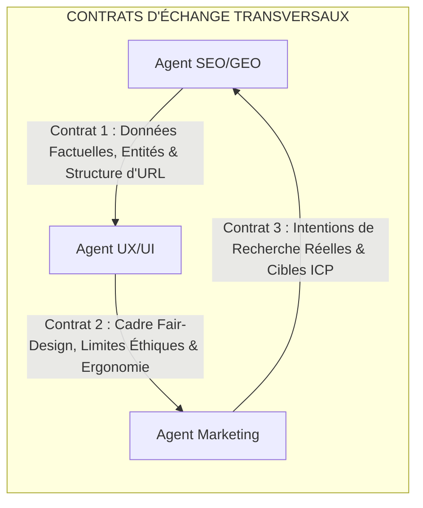
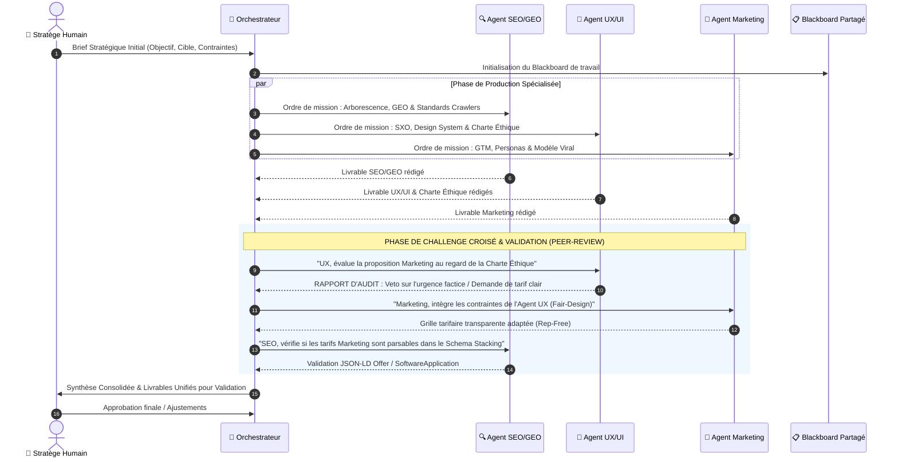

# Cadre Méthodologique & Macro-Architecture Agentique : Le Workspace Multi-Agents pour la Stratégie Produit
**Système Collaboratif d'Ingénierie Stratégique (SEO/GEO ➔ UX/UI ➔ Marketing)**  
**Date :** Octobre 2026  
**Auteur :** Antigravity AI – Pôle Ingénierie des Systèmes Agentiques & Méthodologie Produit  
**Cas d'Application :** `myfootscope.fr` (Football Dataviz as a Service)  
**Livrables Stratégiques Associés :**  
- Acquisition & Ingestion : [`Strategie_SEO_GEO_myfootscope_fr.md`](./Strategie_SEO_GEO_myfootscope_fr.md)  
- Ergonomie & SXO : [`Strategie_UX_UI_Conversion_2026_myfootscope.md`](./Strategie_UX_UI_Conversion_2026_myfootscope.md)  
- Garde-Fou Éthique : [`Charte_Anti_Dark_Patterns_UX_myfootscope.md`](./Charte_Anti_Dark_Patterns_UX_myfootscope.md)  
- Distribution & Monétisation : [`Strategie_Marketing_GTM_myfootscope_fr.md`](./Strategie_Marketing_GTM_myfootscope_fr.md)  

---

## Sommaire Exécutif

1. **Manifeste du Cadre Agentique Stratégique**
   - 1.1. L'Objectif : Un Cadre de Travail Intellectuel et Méthodologique (Non un SaaS runtime)
   - 1.2. Le Principe de la "Pair-Strategy" Humain-Agents
2. **Topologie des Agents & Définition des Rôles (System Prompts & Spécialités)**
   - 2.1. L'Agent Méta-Orchestrateur (*Le Directeur de Stratégie Produit*)
   - 2.2. L'Agent SEO & GEO (*L'Architecte d'Acquisition & d'Ingestion IA*)
   - 2.3. L'Agent UX/UI & Conversion (*L'Ergonome SXO & Gardien Éthique Fair-Design*)
   - 2.4. L'Agent Marketing & Growth (*Le Stratège Go-To-Market & Distribution*)
3. **Contrats d'Interface & Flux d'Artefacts entre Agents**
   - 3.1. Ce que le SEO transmet à l'UX/UI (Contrat d'Ingestion & Entités)
   - 3.2. Ce que l'UX/UI impose au Marketing (Contrat Éthique & Contraintes de Conversion)
   - 3.3. Ce que le Marketing retourne au SEO (Contrat de Demande & Mots-Clés d'Intention)
4. **Dynamique du Workflow de Travail : La Boucle Récursive de Challenge Croisé**
   - 4.1. Pourquoi le Modèle Linéaire Séquentiel échoue
   - 4.2. Le Protocole en 4 Étapes : *Cadrage $\rightarrow$ Production $\rightarrow$ Peer-Review / Veto $\rightarrow$ Synthèse*
   - 4.3. Matrice de Résolution des Conflits Stratégiques
5. **Gouvernance & Place du Pilote Humain (Human-in-the-Loop)**
   - 5.1. L'Humain comme Commanditaire, Donneur d'Ordre et Juge Suprême
   - 5.2. Les Paliers de Validation et Guardrails Décisionnels
6. **Guide Opérationnel d'Instanciation du Cadre (Templates de Prompts & Mémoire)**
   - 6.1. Structure du Contexte Système Partagé (*Blackboard Memory*)
   - 6.2. Matrice d'Évaluation de la Cohérence Inter-Stratégies

---

## 1. Manifeste du Cadre Agentique Stratégique

### 1.1. L'Objectif : Un Cadre de Travail Intellectuel et Méthodologique
Ce document ne décrit pas le code applicatif d'un logiciel SaaS, mais **l'architecture d'un cadre de travail agentique (Multi-Agent Strategic Framework)**. 

L'ambition est de modéliser une organisation d'agents IA spécialisés capables de **collaborer avec le fondateur / l'équipe produit pour concevoir, challenger, aligner et itérer sur l'ensemble de la chaîne de valeur stratégique** : du référencement organique et de l'ingestion par les LLM (SEO/GEO) jusqu'au design d'interaction (UX/UI), au respect des garde-fous éthiques (Anti-Dark Patterns) et à la commercialisation (Marketing GTM).



### 1.2. Le Principe de la "Pair-Strategy" Humain-Agents
* L'humain ne passe plus des semaines à rédiger des documents isolés dans des formats disparates.
* Il formule une intention business, définit des contraintes (ex: *"s'inspirer du benchmark FBref"*, *"interdiction des dark patterns"*, *"intégration de Cloudflare et Nginx Docker"*).
* Le cadre agentique distribue l'effort de réflexion, croise les doctrines scientifiques (brevets Google, étude de Princeton GEO-bench, normes WCAG 2.2, directives DSA) et génère des livrables interconnectés et cohérents.

---

## 2. Topologie des Agents & Définition des Rôles

Chaque agent est doté d'une posture cognitive propre, d'un périmètre d'autorité et de règles de décision strictes.

```
┌────────────────────────────────────────────────────────────────────────────────────────┐
│                     TOPOLOGIE DU CADRE AGENTIQUE STRATÉGIQUE                           │
├──────────────────────────┬─────────────────────────────┬───────────────────────────────┤
│ AGENT & POSTURE          │ MISSION PRINCIPALE          │ ARTEFACT PRODUIT              │
├──────────────────────────┼─────────────────────────────┼───────────────────────────────┤
│ 👑 **Méta-Orchestrateur**│ Cadrage des problématiques, │ Roadmap transversale,         │
│ *The Strategist*         │ distribution des briefs,    │ arbitrage des compromis et    │
│                          │ arbitrage des conflits.     │ matrice de décision unifiée.  │
├──────────────────────────┼─────────────────────────────┼───────────────────────────────┤
│ 🔍 **Agent SEO / GEO**   │ Maximisation de la citation │ Document Master Plan SEO/GEO  │
│ *The Discovery Engine*   │ par les LLM, arborescence,  │ (/llms.txt, Schema Stacking,  │
│                          │ silotage, sitemaps IndexNow.│ règles robots.txt Nginx).     │
├──────────────────────────┼─────────────────────────────┼───────────────────────────────┤
│ 🎨 **Agent UX / UI**     │ Conversion sans friction,   │ Document Master Plan UX/UI &  │
│ *The Fair Designer*      │ SXO, Design System OKLCH,   │ Charte Anti-Dark Patterns     │
│                          │ gardien éthique du produit. │ (Gatekeeper de conformité).   │
├──────────────────────────┼─────────────────────────────┼───────────────────────────────┤
│ 🚀 **Agent Marketing**   │ Product-Led Growth, cibles  │ Document Plan GTM & Growth    │
│ *The Growth Distributor* │ ICP, diffusion virale des   │ (Modèle viral des widgets,    │
│                          │ widgets, pricing rep-free.  │ packaging tarifaire, launch). │
└──────────────────────────┴─────────────────────────────┴───────────────────────────────┘
```

### 2.1. L'Agent Méta-Orchestrateur (*The Product Strategist*)
* **Rôle :** Coordonnateur de la vision. Il s'assure que chaque agent spécialiste ne travaille pas en vase clos et que les productions respectent les contraintes fondatrices du projet.
* **Posture intellectuelle :** Esprit critique, holistique, orienté arbitrage de compromis (*trade-offs*).
* **Compétences :** Décomposition d'objectifs (*Task Decomposition*), validation croisée de cohérence, synthèse exécutive.

### 2.2. L'Agent SEO / GEO (*The Ingestion & Discovery Engine*)
* **Rôle :** Expert de la découvrabilité par les machines (crawlers traditionnels et pipelines RAG d'IA générative).
* **Posture intellectuelle :** Rigueur algorithmique, structuration sémantique, obsession de l'autorité topologique (*Topical Authority*, brevet US8458196B1).
* **Sources de doctrine :** Les 7 guides techniques SEO du dossier `Docs/SEO/`, l'étude de Princeton SIGKDD 2024 (*GEO-bench*), les spécifications W3C des sitemaps et de `/llms.txt`.

### 2.3. L'Agent UX/UI & Conversion (*The Interface Architect & Ethical Gatekeeper*)
* **Rôle :** Expert de l'expérience utilisateur, du SXO (*Search eXperience Optimization*) et garant de l'éthique du produit.
* **Posture intellectuelle :** Empathie cognitive, clarté visuelle, intransigeance sur l'honnêteté des interfaces (*Fair-Design*).
* **Sources de doctrine :** Les guides du dossier `Docs/UI_UX/`, normes WCAG 2.2 AA, Article 25 du Règlement Européen sur les Services Numériques (DSA), RGPD, loi MUPPA.
* **Pouvoir Spécial :** **Droit de Veto Éthique**. Cet agent a l'autorité hiérarchique d'invalider toute proposition marketing qui introduirait un Dark Pattern.

### 2.4. L'Agent Marketing & Growth (*The Viral Engine & Market Distributor*)
* **Rôle :** Expert de la distribution, de la proposition de valeur, du packaging d'offre et de la viralité produit (Product-Led Growth).
* **Posture intellectuelle :** Pragmatisme commercial, ciblage chirurgical d'audiences, orientation valeur perçue et conversion mesurable.
* **Sources de doctrine :** Modèles de croissance Product-Led Growth (PLG), métriques SaaS (CAC, LTV, Churn, $K$-Factor viral), standards de transparence B2B (*rep-free experience*).

---

## 3. Contrats d'Interface & Flux d'Artefacts entre Agents

Dans ce cadre méthodologique, un agent ne produit jamais dans le vide : ses livrables constituent les **spécifications d'entrée (inputs)** d'un autre agent.



### 3.1. Contrat SEO $\rightarrow$ UX/UI : Le Contrat d'Ingestion & de Continuité
* **Ce que le SEO transmet :**
  1. La liste des entités fondamentales et des métriques mathématiques validées dans le cocon sémantique.
  2. La promesse informationnelle formulée aux LLM dans le fichier `/llms.txt`.
  3. L'exigence de la **règle des 30 % initiaux** (la réponse et les preuves chiffrées doivent figurer dès les 100 premiers mots visibles au-dessus du pli).
* **Conséquence pour l'UX :** L'Agent UX ne peut pas concevoir un hero banner purement décoratif ; il est contractuellement obligé d'intégrer des micro-statistiques factuelles dès l'écran d'atterrissage.

### 3.2. Contrat UX/UI $\rightarrow$ Marketing : Le Contrat de Fair-Design & de Faisabilité
* **Ce que l'UX impose au Marketing :**
  1. L'application stricte du **Décalogue Anti-Dark Patterns** : interdiction des faux comptes à rebours, des fausses preuves sociales ou des options pré-cochées.
  2. La symétrie parfaite des parcours : inscription en 1 clic = résiliation en 1 clic.
  3. La transparence tarifaire totale sans devis masqué pour alimenter les comparatifs B2B.
* **Conséquence pour le Marketing :** L'Agent Marketing est bridé dans ses techniques d'acquisition agressives et doit orienter sa copie sur la **supériorité technique et l'intégrité** plutôt que sur des leviers émotionnels culpabilisants.

### 3.3. Contrat Marketing $\rightarrow$ SEO : Le Contrat de Demande & de Positionnement
* **Ce que le Marketing transmet au SEO :**
  1. La cartographie des 3 personas ICP (Créateurs médias, Scouts clubs, Parieurs data).
  2. Le benchmark des faiblesses perçues de FBref et DataMB chez les utilisateurs réels.
  3. Les mots-clés d'intention transactionnelle et de recherche comparée.
* **Conséquence pour le SEO :** L'Agent SEO priorise son arborescence et ses grappes sémantiques sur les requêtes à forte valeur économique plutôt que sur un volume brut sans intention d'achat.

---

## 4. Dynamique du Workflow : La Boucle Récursive de Challenge Croisé

### 4.1. Pourquoi le Modèle Doit Être Bouclant
Une réflexion stratégique produit n'est jamais figée : chaque décision sur un plan a un impact rétroactif sur les autres plans. Le cadre agentique organise une **relecture croisée systématique par les pairs (Peer-Review Loop)**.



---

### 4.2. Matrice de Résolution des Tensions Stratégiques

Le cadre agentique prévoit comment arbitrer les désaccords naturels entre les spécialités :

| Tension Inter-Agents | Posture Spécialiste A | Posture Spécialiste B | Règle d'Arbitrage Automatisée par le Cadre |
| :--- | :--- | :--- | :--- |
| **Volume SEO vs Clarté UX** | L'Agent SEO veut 20 liens internes dans le corps de la fiche joueur. | L'Agent UX signale une saturation visuelle et un risque d'abandon. | **Principe du *Reasonable Surfer* :** Seuls les 3 à 5 liens les plus probables de clic sont conservés dans le corps principal ; le reste est structuré en métadonnées. |
| **Génération de Leads vs "Aha! Moment"** | L'Agent Marketing veut forcer la création de compte dès l'arrivée. | L'Agent UX défend la démo `/explore` sans friction pour un Time-to-Value < 15s. | **Principe Product-Led Growth :** Victoire de l'UX. La démo reste ouverte à 100 % ; l'inscription n'est demandée que pour exporter ou sauvegarder. |
| **Vitesse de Chargement vs Richesse Graphique** | L'Agent Marketing veut une vidéo HD 4K en lecture automatique sur la landing. | L'Agent SEO/UX alerte sur la dégradation du LCP (> 2,5s) et le rebond NavBoost. | **Compromis Technique :** Remplacement de la vidéo lourde par un mockup interactif léger SVG/Canvas ou vidéo optimisée sous 1,5 Mo en lazy-loading. |

---

## 5. Gouvernance & Place du Pilote Humain (Human-in-the-Loop)

Dans ce cadre méthodologique, **les agents proposent, l'humain dispose**. Le système garantit que l'IA ne dérive jamais de l'intention stratégique du fondateur.

```
┌────────────────────────────────────────────────────────────────────────┐
│             NIVEAUX D'AUTONOMIE & RESPONSABILITÉ DÉCISIONNELLE         │
├─────────┬─────────────────────────────┬────────────────────────────────┤
│ NIVEAU  │ TÂCHES COUVERTES            │ STATUT D'EXÉCUTION AGENTIQUE   │
├─────────┼─────────────────────────────┼────────────────────────────────┤
│ **AUTONOME**  │ Documentation technique,    │ Les agents produisent, croisent│
│         │ matrices comparatives,      │ et mettent à jour les documents│
│         │ balisage JSON-LD, checklists│ Markdown en mémoire partagée.  │
├─────────┼─────────────────────────────┼────────────────────────────────┤
│ **SUPERVISÉ** │ Choix de packaging,         │ L'Orchestrateur propose 2 à 3  │
│         │ formulations de promesse,   │ options motivées ; l'humain    │
│         │ arbitrages SEO vs UX        │ sélectionne la trajectoire.    │
├─────────┼─────────────────────────────┼────────────────────────────────┤
│ **RÉSERVÉ**   │ Tarification finale (€),    │ **DÉCISION HUMAINE EXCLUSIVE.**│
│ (HUMAIN)│ engagements contractuels,   │ Aucun agent ne peut modifier   │
│         │ déploiement en production   │ ces éléments sans ordre direct.│
└─────────┴─────────────────────────────┴────────────────────────────────┘
```

---

## 6. Guide Opérationnel d'Instanciation du Cadre

Pour déployer concrètement ce cadre de travail lors de futures sessions de pair-programming stratégique :

### 6.1. Structure du Contexte Système Partagé (*Blackboard Memory*)
Chaque agent est instancié avec un accès en lecture aux 4 livrables fondamentaux situés dans [`Livrables/`](file:///c:/Users/oreeg/Documents/Projet%20%20IA%20G%C3%A9n%C3%A9rative/Livrables) :
1. **Socle de Vérité Technique :** [`Strategie_SEO_GEO_myfootscope_fr.md`](./Strategie_SEO_GEO_myfootscope_fr.md)
2. **Socle d'Expérience & SXO :** [`Strategie_UX_UI_Conversion_2026_myfootscope.md`](./Strategie_UX_UI_Conversion_2026_myfootscope.md)
3. **Socle Éthique Inviolable :** [`Charte_Anti_Dark_Patterns_UX_myfootscope.md`](./Charte_Anti_Dark_Patterns_UX_myfootscope.md)
4. **Socle de Croissance & Offre :** [`Strategie_Marketing_GTM_myfootscope_fr.md`](./Strategie_Marketing_GTM_myfootscope_fr.md)

### 6.2. Protocole de Requête pour le Travail au Quotidien
Lorsque le fondateur souhaite adresser un nouveau sujet (ex: *"Comment aborder le lancement de notre nouvelle métrique de passes progressives ?"*) :
1. **L'Orchestrateur** prend la demande et active la séquence :
   * Demande à l'**Agent SEO** : *"Quelle est la grappe d'entités et la structure d'URL pour cette métrique ?"*
   * Demande à l'**Agent UX** : *"Comment afficher cette métrique dans le radar ECharts sans saturer l'écran ?"*
   * Demande à l'**Agent Marketing** : *"Quel cas d'usage concret de match de Ligue 1 allons-nous utiliser pour illustrer sa valeur ?"*
2. Les agents produisent leurs sous-spécifications.
3. L'Agent UX vérifie l'absence de promesse trompeuse.
4. L'Orchestrateur consolide la réponse finale pour le fondateur.
