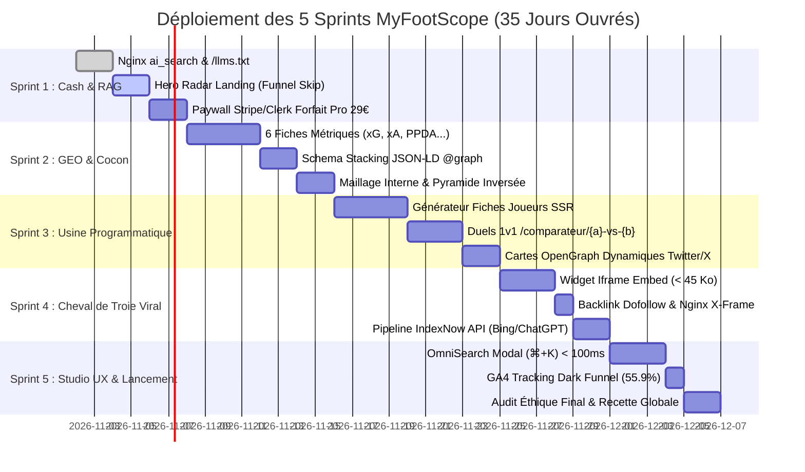

# 🏁 Plan d'Exécution Complet des Sprints : Déploiement SEO, Ingestion IA & Ventes MyFootScope
<!-- Spécification Opérationnelle Agile - 5 Sprints vers la Monétisation SaaS -->

> **Vision Exécutive pour le Fondateur :**  
> Ce document traduit l'ensemble de notre stratégie (SEO/GEO, SXO, Fair-Design, Marketing GTM) en un **plan de développement agile et séquentiel en 5 Sprints**.  
> Chaque sprint possède un **Sprint Goal business orienté vente**, des User Stories détaillées, des tâches techniques précises (fichiers concernés dans `football-dataviz-api`) et des critères d'acceptation stricts (Definition of Done - DoD).

---

## 📅 Synthèse du Calendrier de Déploiement (Gantt)

---

## 🏃 SPRINT 1 : "Quick-Win Cash & Déverrouillage RAG" (P0 - Must Have)
* **Durée estimée :** 5 jours ouvrés
* **Sprint Goal Business :** Débloquer immédiatement les citations RAG gratuites dans Perplexity/Claude et permettre aux visiteurs de la Landing Page d'essayer le radar en 15 secondes et d'acheter le forfait Pro à 29 € / mois.

### 📋 Backlog Détaillé du Sprint 1

#### US 1.1 : Déblocage Nginx pour l'Ingestion IA (`ai_search`)
* **Fichiers impactés :** `docker/nginx/conf.d/00-maps.conf`, `docker/nginx/conf.d/10-app-frontend.conf`
* **Tâches Techniques :**
  1. Scinder la catégorie `$bot_category` : isoler `PerplexityBot`, `Claude-Search`, `ChatGPT-User` dans `"ai_search"`.
  2. Associer la catégorie `"ai_search"` au header HTTP `X-Robots-Tag: index, follow, max-snippet:-1`.
  3. Conserver `"ai_training"` (`CCBot`, `GPTBot`) sous `noai, noimageai`.
* **Critères d'Acceptation (DoD) :**
  - [ ] Un test `curl -A "PerplexityBot"` sur la racine renvoie un statut HTTP 200 avec le header `X-Robots-Tag: index, follow`.
  - [ ] Aucune régression sur le blocage des scrapers agressifs (`bad_bot`).

#### US 1.2 : Publication du Fichier Standard `/llms.txt`
* **Fichiers impactés :** `docker/nginx/conf.d/10-app-frontend.conf`, `public/llms.txt`
* **Tâches Techniques :**
  1. Rédiger le fichier Markdown brut `llms.txt` (sommaire exécutif, proposition de valeur, structure d'API, 3 piliers sémantiques).
  2. Configurer la route Nginx `location = /llms.txt` avec `Content-Type: text/markdown; charset=utf-8` et cache 24h.
* **Critères d'Acceptation (DoD) :**
  - [ ] `https://myfootscope.fr/llms.txt` est accessible publiquement, sans redirection, en moins de 50 ms.
  - [ ] Le fichier pèse moins de 12 Ko et passe le validateur de syntaxe standard.

#### US 1.3 : Intégration du Composant `<HeroRadarPreview />` (Funnel Skip)
* **Fichiers impactés :** `front/src/routes/index.tsx`, `front/src/components/radar/`
* **Tâches Techniques :**
  1. Intégrer dans les 30 % initiaux de la Landing Page un radar SVG interactif pré-chargé avec deux stars mondiales (ex: *Lamine Yamal vs Ousmane Dembélé*).
  2. Permettre la permutation de 2 métriques en direct ("Style de jeu" / "Création offensive") sans rechargement de page.
  3. Ajouter un bouton de téléchargement PNG instantané avec watermark feutré MyFootScope.
* **Critères d'Acceptation (DoD) :**
  - [ ] Le composant est interactif en moins de 1,5 seconde au premier chargement.
  - [ ] Aucun formulaire, popup ni demande d'email n'interrompt la manipulation.

#### US 1.4 : Paywall Transparent & Checkout Stripe Forfait Pro (29 € / mois)
* **Fichiers impactés :** `front/src/routes/pricing.tsx`, `src/plugins/stripe.ts` (ou Clerk Billing)
* **Tâches Techniques :**
  1. Afficher la grille tarifaire à 3 colonnes : Découverte (0 €), Pro Analyst (29 € TTC/mois), Data API (149 € HT/mois).
  2. Brancher le bouton "Passer à Pro" vers la session de paiement Stripe Checkout (abonnement mensuel sans engagement).
  3. Intégrer dans le portail client l'annulation en 1 clic (respect de l'Art. 25 DSA et loi MUPPA).
* **Critères d'Acceptation (DoD) :**
  - [ ] Un paiement test à 29 € s'exécute avec succès et active les droits Pro instantanément.
  - [ ] La résiliation est réalisable depuis le compte en 2 clics sans contact du support.
  - [ ] Veto UX validé : Zéro case pré-cochée, aucun coût caché.

---

## 🏃 SPRINT 2 : "Autorité GEO & Cocon Sémantique Éducatif" (P1 - Should Have)
* **Durée estimée :** 7 jours ouvrés
* **Sprint Goal Business :** Devenir la référence absolue citée par Google et les IA conversationnelles (ChatGPT, Perplexity) sur le lexique tactique du football moderne.

### 📋 Backlog Détaillé du Sprint 2

#### US 2.1 : Production & Intégration des 6 Fiches Métriques Piliers
* **Fichiers impactés :** `front/src/routes/metriques/`
* **Tâches Techniques :**
  1. Créer les 6 routes statiques :
     * `/metriques/expected-goals-xg`
     * `/metriques/expected-assists-xa`
     * `/metriques/passes-progressives`
     * `/metriques/ppda-pressing`
     * `/metriques/expected-threat-xt`
     * `/metriques/field-tilt`
  2. Rédiger le contenu selon la règle de la pyramide inversée (définition brute en < 50 mots dès le H1).
  3. Insérer un mini-radar interactif d'illustration sur chaque page.
* **Critères d'Acceptation (DoD) :**
  - [ ] Chaque page affiche une densité factuelle $\ge 12\,\text{stats/100 mots}$.
  - [ ] Temps de chargement TTFB < 150 ms.

#### US 2.2 : Balisage Schema Stacking JSON-LD `@graph`
* **Fichiers impactés :** `front/src/components/seo/JsonLd.tsx`, `front/src/routes/index.tsx`
* **Tâches Techniques :**
  1. Concevoir le générateur de balises JSON-LD imbriquant `Organization`, `WebApplication`, `Offer` et `FAQPage`.
  2. Injecter les données structurées des offres tarifaires (0 € et 29 €) pour alimenter les comparateurs IA.
* **Critères d'Acceptation (DoD) :**
  - [ ] Validation sans erreur ni avertissement sur l'outil officiel *Google Rich Results Test*.
  - [ ] Au minimum 4 entités interconnectées par `@id` dans le `@graph`.

#### US 2.3 : Maillage Interne Contextuel (Reasonable Surfer)
* **Fichiers impactés :** `front/src/components/player/MetricRow.tsx`
* **Tâches Techniques :**
  1. Lier chaque intitulé de métrique (ex: "xG", "Passes progressives") dans les tableaux de stats vers sa fiche éducative dédiée.
  2. Ajouter une ancre sémantique claire au survol (*"Comprendre le calcul des passes progressives"*).
* **Critères d'Acceptation (DoD) :**
  - [ ] Les liens transmettent le jus sémantique sans perturber la fluidité de lecture du tableau.

---

## 🏃 SPRINT 3 : "L'Usine SEO Programmatique (Joueurs & Duels)" (P1 - Should Have)
* **Durée estimée :** 8 jours ouvrés
* **Sprint Goal Business :** Déployer 50 000 points d'entrée organiques sur Google pour capter la longue traîne et devenir l'outil de référence pour les débats sur les réseaux sociaux.

### 📋 Backlog Détaillé du Sprint 3

#### US 3.1 : Générateur de Fiches Joueurs en Rendu Côté Serveur (SSR)
* **Fichiers impactés :** `front/src/routes/joueur/$slug.tsx`, `src/routes/api/v1/players/`
* **Tâches Techniques :**
  1. Configurer la génération dynamique de l'URL `/joueur/{slug}` avec rendu HTML pré-calculé pour les robots.
  2. Insérer le radar SVG rendu côté serveur (garantissant l'indexabilité complète sans exécution JS).
  3. Générer un paragraphe textuel unique de 120 mots synthétisant les 3 percentiles majeurs du joueur.
* **Critères d'Acceptation (DoD) :**
  - [ ] La page est entièrement lisible avec JavaScript désactivé.
  - [ ] Le titre dynamique suit la formule : `<Nom> Stats, Radar & Percentiles 2026 - MyFootScope`.

#### US 3.2 : Moteur de Duels 1v1 (`/comparateur/{a}-vs-{b}`)
* **Fichiers impactés :** `front/src/routes/comparateur/$duel.tsx`
* **Tâches Techniques :**
  1. Implémenter le routage canonique normalisé (ordre alphabétique pour éliminer le contenu dupliqué).
  2. Afficher la comparaison polygonale superposée des deux joueurs (ex: Bleu vs Ambre).
  3. Permettre d'ajuster les filtres (saison en cours, 365 derniers jours).
* **Critères d'Acceptation (DoD) :**
  - [ ] `/comparateur/mbappe-vs-haaland` et `/comparateur/haaland-vs-mbappe` résolvent sur une URL canonique unique.
  - [ ] L'affichage du comparateur s'exécute en moins de 300 ms.

#### US 3.3 : Cartes OpenGraph Dynamiques pour Partage Viral sur X / Reddit
* **Fichiers impactés :** `src/services/og-generator.ts`, `docker/nginx/conf.d/20-app-api.conf`
* **Tâches Techniques :**
  1. Créer un endpoint Fastify générant à la volée une image PNG 1200x630 du radar duel.
  2. Injecter les balises `<meta property="og:image">` et `<meta name="twitter:card" content="summary_large_image">`.
* **Critères d'Acceptation (DoD) :**
  - [ ] Le partage d'un lien `/comparateur/dembele-vs-yamal` sur Twitter/X affiche automatiquement le visuel du radar dans le feed.

---

## 🏃 SPRINT 4 : "Le Cheval de Troie Viral (Widget Embed & IndexNow)" (P1 - Should Have)
* **Durée estimée :** 7 jours ouvrés
* **Sprint Goal Business :** Déclencher une boucle de croissance virale passive ($K \ge 0,40$) en permettant aux médias d'intégrer nos radars et automatiser l'indexation ultra-fraîche post-matchs.

### 📋 Backlog Détaillé du Sprint 4

#### US 4.1 : Widget Iframe Ultra-Léger Intégrable (`<iframe src="...">`)
* **Fichiers impactés :** `front/src/routes/embed/radar/$id.tsx`, `docker/nginx/conf.d/10-app-frontend.conf`
* **Tâches Techniques :**
  1. Développer une vue allégée du radar (< 45 Ko au chargement, sans barre de navigation).
  2. Insérer le badge feutré cliquable : *"Données tactiques par MyFootScope.fr"* avec lien `dofollow` vers la fiche complète du joueur.
  3. Configurer Nginx pour autoriser l'affichage en iframe tiers (`X-Frame-Options` assoupli sur `/embed/`).
* **Critères d'Acceptation (DoD) :**
  - [ ] Le widget s'intègre parfaitement dans un article WordPress / Ghost sans conflit de CSS.
  - [ ] Le clic sur le badge redirige vers MyFootScope avec le tag UTM `?utm_source=embed_widget`.

#### US 4.2 : Modal Générateur de Code Embed pour les Rédacteurs
* **Fichiers impactés :** `front/src/components/radar/ShareModal.tsx`
* **Tâches Techniques :**
  1. Ajouter un bouton "Intégrer ce radar sur votre site" sur chaque fiche joueur.
  2. Fournir le snippet HTML prêt à copier-coller avec choix de la taille (Responsive, Carré, Bannière).
* **Critères d'Acceptation (DoD) :**
  - [ ] Copie en 1 clic dans le presse-papier avec notification toast de confirmation.

#### US 4.3 : Pipeline d'Indexation Ultra-Fraîche via l'API IndexNow
* **Fichiers impactés :** `src/services/indexnow.ts`, `docker/nginx/conf.d/10-app-frontend.conf`
* **Tâches Techniques :**
  1. Générer et héberger la clé d'authentification IndexNow à la racine (`/indexnow-key.txt`).
  2. Déclencher un appel HTTP POST vers `https://api.indexnow.org` à la fin de chaque pipeline d'ingestion de match avec la liste des URLs des joueurs mis à jour.
* **Critères d'Acceptation (DoD) :**
  - [ ] Les pages de joueurs ayant joué la veille sont soumises à Bing en moins de 15 minutes post-match.

---

## 🏃 SPRINT 5 : "OmniSearch, Dark Funnel & Lancement Commercial" (P2 - Could Have)
* **Durée estimée :** 8 jours ouvrés
* **Sprint Goal Business :** Parfaire l'expérience utilisateur studio, configurer le tracking de l'attribution IA (Dark Funnel 55,9 %) et ouvrir la plateforme aux premières cohortes payantes.

### 📋 Backlog Détaillé du Sprint 5

#### US 5.1 : OmniSearch Modal (`⌘+K` / `Ctrl+K`) Haute Vitesse
* **Fichiers impactés :** `front/src/components/search/OmniSearchModal.tsx`, `src/routes/api/v1/search.ts`
* **Tâches Techniques :**
  1. Développer l'interface modale de recherche globale avec raccourci clavier `⌘+K` / `Ctrl+K` et bouton tactile mobile.
  2. Optimiser la requête de recherche trigramme Fastify / PostgreSQL pour renvoyer les 10 meilleurs résultats en moins de 80 ms.
  3. Afficher les résultats segmentés : Joueurs, Clubs, Compétitions.
* **Critères d'Acceptation (DoD) :**
  - [ ] Navigation clavier intégrale (flèches haut/bas, Entrée pour valider, Échap pour fermer).
  - [ ] Temps de réponse ressenti instantané sans scintillement.

#### US 5.2 : Configuration GA4 du Dark Funnel & Attribution IA
* **Fichiers impactés :** Configuration Google Analytics 4 & Google Search Console
* **Tâches Techniques :**
  1. Créer le groupe de canaux personnalisé (*Custom Channel Grouping*) nommé `AI Referral` isolant `chatgpt.com`, `claude.ai`, `gemini.google.com` et `perplexity.ai`.
  2. Mettre en place un tableau de bord de corrélation entre les impressions de marque (*Branded Search*) et les pics de citations IA.
* **Critères d'Acceptation (DoD) :**
  - [ ] Les visites issues des LLMs sont isolées du canal `Direct` ou `Referral` générique.

#### US 5.3 : Audit Éthique Final Anti-Dark Patterns & Go Live
* **Fichiers impactés :** L'ensemble du tunnel de vente et de résiliation
* **Tâches Techniques :**
  1. Revue croisée par l'Agent **🎨 `@agent-ux-ui`** de toutes les pages selon la [Charte Anti-Dark Patterns](file:///c:/Users/oreeg/Documents/Projet%20%20IA%20G%C3%A9n%C3%A9rative/Livrables/03_UX_UI_Conversion/Charte_Anti_Dark_Patterns_UX_myfootscope.md).
  2. Validation de la conformité DSA (Article 25) et RGPD.
  3. Clôture de la mission au Blackboard et feu vert pour le lancement public.
* **Critères d'Acceptation (DoD) :**
  - [ ] Rapport de veto vierge (100 % de conformité éthique).
  - [ ] Validation finale par le fondateur (Human-in-the-Loop).

---

## 🎯 Matrice de Responsabilité par Agent Antigravity

| Sprint | Agent Pilote | Agents Contributeurs | Rôle de l'Orchestrateur |
| :--- | :--- | :--- | :--- |
| **Sprint 1 : Cash & RAG** | 🚀 `@agent-marketing` & 🔍 `@agent-seo-geo` | 🧭 `@agent-code-navigator`, 🎨 `@agent-ux-ui` | Arbitrer la simplicité du Funnel Skip et valider l'intégration Stripe. |
| **Sprint 2 : Cocon GEO** | 🔍 `@agent-seo-geo` | 🎨 `@agent-ux-ui` | Garantir la haute densité factuelle et le respect de la pyramide inversée. |
| **Sprint 3 : Usine Programmatique** | 🧭 `@agent-code-navigator` | 🔍 `@agent-seo-geo`, 🚀 `@agent-marketing` | Vérifier la performance de rendu SSR et la normalisation des URLs. |
| **Sprint 4 : Viralité & Embed** | 🚀 `@agent-marketing` | 🎨 `@agent-ux-ui`, 🔍 `@agent-seo-geo` | Contrôler la légèreté du composant (< 45 Ko) et le backlink dofollow. |
| **Sprint 5 : Studio UX & Lancement** | 🎨 `@agent-ux-ui` | 📡 `@agent-market-intelligence` | Exercer l'audit éthique final et consolider le bilan pour le fondateur. |

---

*Ce document constitue le plan de production officiel de MyFootScope (`Livrables/01_Roadmap_Epics/`).*
