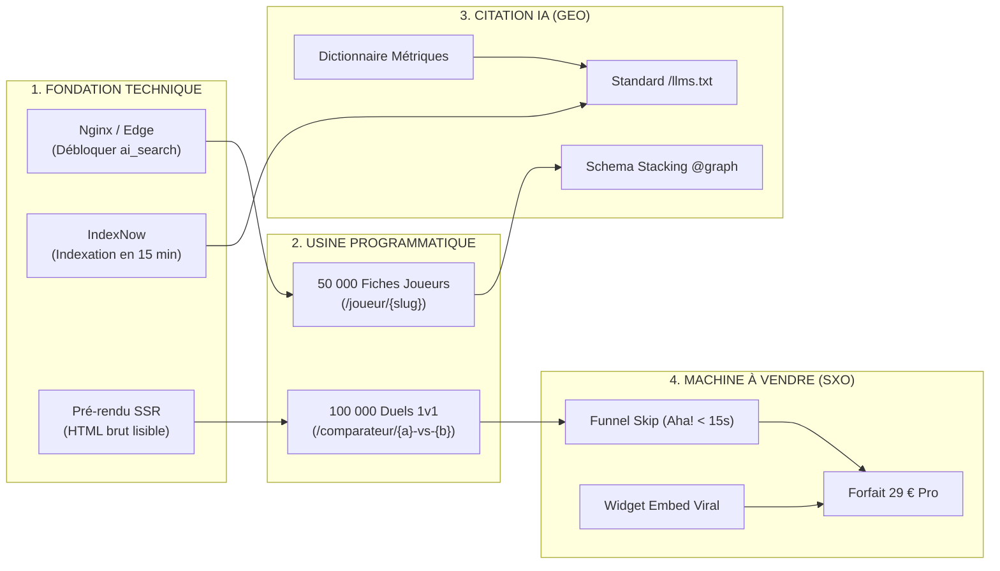

# 🚀 Stratégie SEO Globale, Roadmap & Epics Fonctionnelles MyFootScope
<!-- Document Produit & Technique de Référence - Objectif : Acquisition Massive & Vente SaaS 2026 -->

> **À l'attention du Fondateur :**  
> Ce document est conçu pour **démystifier le SEO**, expliquer concrètement comment chaque composante fait venir des visiteurs qualifiés, et fournir un **découpage fonctionnel prêt pour le développement (Epics & User Stories)** pour transformer ce trafic en clients payants (29 € / mois).

---

## 1. Le SEO Expliqué Simplement : Le Modèle de la Concession Automobile

Si vous n'êtes pas du métier, imaginez le SEO moderne comme une concession de voitures de sport :

| Composante SEO | Analogie Grand Public | Rôle Concret pour MyFootScope |
| :--- | :--- | :--- |
| **1. SEO Technique & Edge** | **Les routes d'accès et les portes du magasin.** | Si la route est barrée (mauvais Nginx) ou si la porte est fermée (JavaScript non lu), ni Google ni ChatGPT ne peuvent entrer. |
| **2. SEO Programmatique** | **Avoir 50 000 voitures en vitrine plutôt qu'une seule.** | Au lieu d'espérer ranker sur "stats foot", on crée automatiquement une page pour chaque joueur (`/joueur/yamal`) et chaque duel (`/comparateur/yamal-vs-dembele`). |
| **3. Le Cocon Sémantique (GEO)** | **Le guide expert qui forme les vendeurs et répond aux questions.** | Devenir la référence absolue citée par ChatGPT/Perplexity sur la définition des métriques modernes ($xG$, Passes progressives). |
| **4. Le Cheval de Troie Viral** | **Le logo et l'autocollant sur chaque voiture qui roule en ville.** | Chaque graphique partagé ou intégré par un média sur son blog ramène du monde gratuitement chez nous via notre widget. |
| **5. Le SXO & Conversion** | **L'art de faire essayer la voiture en 10 secondes et de vendre l'option Pro.** | L'internaute teste le radar immédiatement (Funnel Skip) et s'abonne à 29 € pour débloquer les 55 ligues et l'export 4K. |

---

## 2. La Stratégie SEO Globale en 4 Piliers d'Acquisition

---

## 3. Le Backlog Produit : Découpage Fonctionnel en 5 Epics

Voici le découpage fonctionnel rationnel prêt à être injecté dans un Jira, Linear ou GitHub Projects :

---

### 🟢 EPIC 1 : Déverrouillage Technique & Ingestion IA (Infrastructure)
> **Objectif Business :** Rendre le site 100 % lisible par Google, Bing et les moteurs IA conversationnels (ChatGPT, Perplexity, Claude), et indexer chaque nouvelle stat en moins de 15 minutes.

#### User Story 1.1 : Séparation Nginx `ai_search` vs `ai_training`
* **En tant que :** Moteur IA conversationnel (PerplexityBot, Claude-Search, ChatGPT-User).
* **Je veux :** Accéder aux pages et recevoir l'en-tête `X-Robots-Tag: index, follow, max-snippet:-1`.
* **Afin de :** Pouvoir citer MyFootScope dans mes réponses aux utilisateurs en direct.
* **Critères d'acceptation (DoD) :**
  - [ ] Le fichier `football-dataviz-api/docker/nginx/conf.d/00-maps.conf` classe `PerplexityBot`, `ChatGPT-User` et `Claude-Search` en `ai_search`.
  - [ ] Ces bots reçoivent un statut HTTP 200 et l'en-tête `index, follow`.
  - [ ] Les bots d'entraînement brut (`CCBot`, `GPTBot`) restent restreints avec `noai, noimageai`.

#### User Story 1.2 : Déploiement du Sommaire Standard `/llms.txt`
* **En tant que :** Agent RAG autonome.
* **Je veux :** Télécharger un fichier Markdown brut à l'URL `myfootscope.fr/llms.txt`.
* **Afin de :** Comprendre instantanément toute l'offre et l'arborescence du site sans scraper du HTML lourd.
* **Critères d'acceptation (DoD) :**
  - [ ] La route `GET /llms.txt` renvoie un contenu `text/markdown` avec la proposition de valeur, les 3 piliers et les liens vers les métriques.
  - [ ] Le fichier pèse moins de 15 Ko et respecte la norme Jeremy Howard.

#### User Story 1.3 : Pipeline d'Indexation Ultra-Fraîche via IndexNow
* **En tant que :** Responsable Acquisition.
* **Je veux :** Envoyer un ping automatique à l'API IndexNow (Bing / OpenAI) dès qu'un match se termine et que les stats sont mises à jour.
* **Afin que :** Les nouvelles statistiques soient indexées sur Bing (qui alimente 87 % des recherches ChatGPT) en moins d'un quart d'heure.
* **Critères d'acceptation (DoD) :**
  - [ ] Clé API IndexNow générée et hébergée à la racine (`/indexnow-key.txt`).
  - [ ] Script Fastify post-import qui ping l'endpoint `api.indexnow.org` avec la liste des URLs des joueurs du match.

---

### 🟢 EPIC 2 : L'Usine SEO Programmatique (50 000 Fiches & Duels)
> **Objectif Business :** Multiplier les points d'entrée sur Google en captant des requêtes précises à forte intention (*Long-Tail SEO* : ex: "percentiles passes lamine yamal", "comparaison haaland mbappé 2026").

#### User Story 2.1 : Moteur de Génération des Fiches Joueurs (`/joueur/{slug}`)
* **En tant que :** Passionné ou scout cherchant un joueur sur Google.
* **Je veux :** Atterrir sur une page dédiée propre, rapide et complète avec son radar DataViz.
* **Afin de :** Voir immédiatement ses percentiles et ses points forts sans inscription.
* **Critères d'acceptation (DoD) :**
  - [ ] Route dynamique TanStack Router `/joueur/$slug` générée côté serveur (SSR ou pre-rendering statique).
  - [ ] Intégration du composant SVG Radar rendu côté serveur (lisible sans JS).
  - [ ] Paragraphe rédigé automatiquement de 100 à 120 mots à haute densité factuelle résumant les performances du joueur.
  - [ ] Titre SEO dynamique : `<title>{Nom} Stats & Radar Percentiles 2026 - MyFootScope</title>`.

#### User Story 2.2 : Générateur Automatique de Duels 1v1 (`/comparateur/{slug-a}-vs-{slug-b}`)
* **En tant que :** Internaute participant à un débat sur les réseaux sociaux.
* **Je veux :** Générer une URL unique de comparaison entre deux joueurs avec un aperçu visuel (OpenGraph).
* **Afin de :** Partager le lien sur X/Twitter pour prouver mon argument avec des chiffres.
* **Critères d'acceptation (DoD) :**
  - [ ] URL canonique normalisée (ordre alphabétique pour éviter le contenu dupliqué : `/comparateur/dembele-vs-yamal`).
  - [ ] Balises meta `og:image` dynamiques pointant vers le rendu PNG du radar duel.
  - [ ] Bouton "Copier le lien" et "Télécharger l'image".

---

### 🟢 EPIC 3 : Le Cocon Sémantique Éducatif & Domination GEO
> **Objectif Business :** Devenir la source incontournable citée par les intelligences artificielles sur le vocabulaire du football moderne.

#### User Story 3.1 : Dictionnaire Interactif des 6 Métriques Tactiques Clés
* **En tant que :** Journaliste, parieur ou fan voulant comprendre les stats modernes.
* **Je veux :** Consulter des guides didactiques sur `/metriques/expected-goals-xg`, `/metriques/passes-progressives`, etc.
* **Afin de :** Comprendre la formule, voir des exemples concrets de joueurs et être redirigé vers l'outil.
* **Critères d'acceptation (DoD) :**
  - [ ] 6 fiches rédigées selon la règle de la pyramide inversée (définition brute en < 50 mots dès le H1).
  - [ ] Intégration d'un mini-radar d'exemple embarqué illustrant la métrique.
  - [ ] Maillage interne bidirectionnel : chaque fiche joueur mentionnant "xG" fait un lien vers cette page.

#### User Story 3.2 : Schema Stacking JSON-LD `@graph`
* **En tant que :** Crawler sémantique (Googlebot, PerplexityBot).
* **Je veux :** Lire un graphe JSON-LD reliant l'Organisation, le Logiciel, les Offres tarifaires et les FAQ.
* **Afin de :** Comprendre sans aucune ambiguïté ce que vend MyFootScope et à quel prix.
* **Critères d'acceptation (DoD) :**
  - [ ] Balise `<script type="application/ld+json">` présente sur toutes les pages piliers.
  - [ ] Au minimum 3 schémas imbriqués (`Organization`, `WebApplication`, `Offer`, `FAQPage`).

---

### 🟢 EPIC 4 : Le Cheval de Troie Viral (Widget Embed & Backlinks)
> **Objectif Business :** Obtenir des centaines de backlinks ultra-puissants gratuitement en laissant les blogs, médias et créateurs intégrer nos radars chez eux.

#### User Story 4.1 : Composant Iframe Ultra-Léger Intégrable (`<iframe src="...">`)
* **En tant que :** Blogueur ou rédacteur de média football (ex: média club, blog tactique).
* **Je veux :** Copier un code d'intégration en 1 clic pour afficher un radar interactif dans mon article.
* **Afin de :** Rendre mon article interactif sans payer un graphiste.
* **Critères d'acceptation (DoD) :**
  - [ ] Route dédiée `/embed/radar/{id}` optimisée (< 45 Ko, pas de scripts inutiles).
  - [ ] Badge feutré discret en bas du widget : *"Données par MyFootScope.fr"* avec un lien dofollow vers la page du joueur.
  - [ ] Configuration Nginx `X-Frame-Options` assouplie sur `/embed/` pour autoriser l'affichage tiers.

---

### 🟢 EPIC 5 : La Machine de Conversion SXO (Du Clic à la Vente 29 €)
> **Objectif Business :** Convertir le trafic d'acquisition (qui arrive par milliers sur les fiches joueurs et la landing) en abonnés payants à 29 € / mois.

#### User Story 5.1 : Le Funnel Skip sur la Landing Page (Preuve < 15 secondes)
* **En tant que :** Visiteur découvrant MyFootScope.
* **Je veux :** Manipuler un radar réel immédiatement sur l'écran d'accueil sans créer de compte ni donner d'email.
* **Afin de :** Ressentir immédiatement la puissance de l'outil ("Aha! Moment").
* **Critères d'acceptation (DoD) :**
  - [ ] Le premier écran (*Above the Fold*) charge un composant interactif pré-rempli (ex: Mbappé vs Haaland).
  - [ ] L'utilisateur peut changer d'onglet ("Style de jeu", "Défense") et voir le graphique s'animer.
  - [ ] Bouton CTA primaire direct : *"Explorer 50 000 joueurs (Gratuit sans CB)"*.

#### User Story 5.2 : L'OmniSearch Modal (`⌘+K`) comme Déclencheur d'Inscription
* **En tant que :** Utilisateur séduit par la démo.
* **Je veux :** Chercher mon propre joueur favori via `⌘+K`.
* **Afin de :** Voir ses statistiques immédiatement.
* **Critères d'acceptation (DoD) :**
  - [ ] Raccourci clavier `⌘+K` / `Ctrl+K` et champ de recherche tactile sur mobile.
  - [ ] Autocomplétion sous 100 ms via l'API Fastify.
  - [ ] Redirection directe vers la fiche `/joueur/{slug}`.

#### User Story 5.3 : Le Paywall Naturel & Éthique (Conversion Pro 29 €)
* **En tant que :** Utilisateur régulier qui souhaite aller plus loin.
* **Je veux :** Comprendre clairement ce que m'apporte le forfait Pro à 29 € / mois par rapport à la version gratuite.
* **Afin de :** Sortir ma carte bancaire en toute confiance et sans piège.
* **Critères d'acceptation (DoD) :**
  - [ ] Déclenchement naturel du paywall sur des fonctionnalités premium précises :
    * Téléchargement SVG vectoriel ou PNG 4K (pour créateurs).
    * Accès aux ligues secondaires (ex: Championship, D2, Amérique du Sud) au-delà du Top 5.
    * Historique sur 5 saisons.
  - [ ] Modale de paiement Stripe/Clerk avec prix net (29 € TTC), sans frais cachés.
  - [ ] Mention claire : *"Sans engagement • Résiliation en 1 clic dans votre profil (Loi MUPPA/DSA)"*.

---

## 4. Matrice de Priorisation & Plan d'Action (Méthode MoSCoW)

Pour maximiser le retour sur investissement sans vous disperser, voici l'ordre d'implémentation conseillé :

| Priorité | User Story | Effort Dév | Impact Business / Ventes |
| :--- | :--- | :--- | :--- |
| **P0 (Must Have)** | **US 1.1** : Déblocage Nginx pour Perplexity et Claude | 1 demi-journée | Débloque immédiatement les citations RAG gratuites. |
| **P0 (Must Have)** | **US 5.1** : Funnel Skip & Hero Radar sur la Landing Page | 2 jours | Multiplie le taux d'activation par 3 dès le jour 1. |
| **P0 (Must Have)** | **US 5.3** : Paywall transparent et abonnement Pro 29 € | 2 jours | **Permet d'encaisser les premiers paiements !** |
| **P1 (Should Have)** | **US 2.1** : Fiches Joueurs SEO Programmatique (Top 5 ligues) | 4 jours | Ouvre les vannes du trafic Google organique. |
| **P1 (Should Have)** | **US 4.1** : Widget Iframe avec backlink "Powered by" | 2 jours | Génère des backlinks naturels et une viralité passive. |
| **P2 (Could Have)** | **US 2.2** : URLs de duels 1v1 avec OpenGraph partagé | 3 jours | Explose lors des soirs de grands matchs sur les réseaux. |
| **P2 (Could Have)** | **US 1.3** : Pings IndexNow automatiques post-matchs | 1 jour | Fraîcheur d'indexation maximale sur Bing / ChatGPT. |

---

## 5. Comment Mesurer le Succès Commercial (KPIs de Vente)

Le succès de cette stratégie ne se mesure pas en "mots-clés positionnés", mais en **revenus récurrents (MRR)** :

1. **Volume d'Acquisition :** Nombre de sessions organiques Google + Référents IA (ChatGPT / Perplexity).
2. **Taux d'Activation (Aha! Moment) :** Pourcentage d'utilisateurs qui manipulent un radar dans les 30 premières secondes (Cible : $> 45\,\%$).
3. **Conversion Freemium $\rightarrow$ Pro :** Pourcentage de visiteurs gratuits qui s'abonnent au forfait 29 € pour débloquer l'export HD ou les ligues étendues (Cible SaaS : $2{,}5\,\%$ à $4\,\%$).
4. **Facteur Viral du Widget ($K$-Factor) :** Pourcentage de visiteurs arrivant sur MyFootScope après avoir cliqué sur un widget intégré sur un blog tiers (Cible : $K \ge 0{,}40$).

---

*Ce document de spécification est validé et prêt pour être arbitré par le fondateur et exécuté dans le code.*
