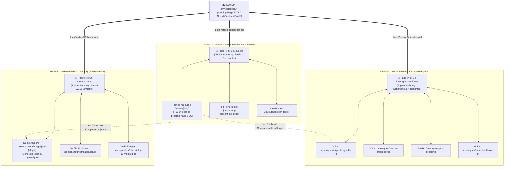
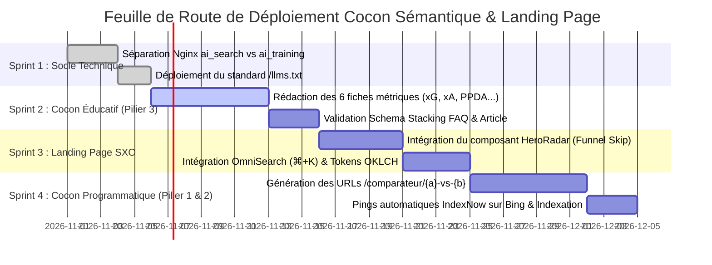

# 🎯 Stratégie Cocon Sémantique (Topic Authority) & Landing Page de Conversion SXO
<!-- Document Stratégique Officiel MyFootScope - Version 2026 -->

> **Périmètre du Livrable :**  
> Ce document définit l'architecture sémantique globale de `myfootscope.fr` (cocon sémantique et autorité thématique), son positionnement face aux leaders du marché (DataMB, FBref, Understat, Sofascore), et la spécification ergonomique, rédactionnelle et technique complète de sa **Landing Page de conversion** sous le prisme du SXO (*Search Experience Optimization*) et du GEO (*Generative Engine Optimization*).

---

## 1. Synthèse Exécutive & Thèse Stratégique

Le marché de la data footballistique est aujourd'hui polarisé entre deux extrêmes :
1. **L'austérité brute et le SEO historique :** Des plateformes comme **FBref** dominent le trafic organique grâce à leur profondeur encyclopédique, mais souffrent d'une ergonomie obsolète (tableaux statiques des années 90, zéro composant visuel moderne, illisibles sur mobile).
2. **La dataviz visuelle mais aveugle au SEO :** Des outils comme **DataMB** ont conquis les réseaux sociaux avec des radars de percentiles attrayants, mais sont techniquement **invisibles pour les moteurs de recherche et les agents IA** en raison d'un manque total de contenu textuel structuré et d'arborescence programmatique.

### La Thèse MyFootScope : Le "Sweet Spot" de 2026
`myfootscope.fr` fusionne le meilleur des deux mondes :
* **La rigueur et l'exhaustivité statistique de FBref** (métriques avancées xG, xA, xT, passes progressives, percentiles par poste).
* **La modernité visuelle et la viralité de DataMB** (radars interactifs, comparaisons 1v1 fluides, exports graphiques épurés).
* **Une expérience produit studio (Design System OKLCH feutré)** exempte de toute pollution publicitaire de paris sportifs (différenciation nette face à Sofascore).
* **Une infrastructure nativement conçue pour l'IA (GEO / GraphRAG)** : balisage Schema Stacking `@graph`, fichier `/llms.txt` haute densité et indexation temps réel via IndexNow.

---

## 2. Intelligence Marché & Benchmark Concurrentiel

L'investigation menée par le sous-agent `subagent-market-intelligence` dresse la cartographie comparative suivante :

| Dimension d'Analyse | FBref (Sports-Reference) | DataMB (`datamb.football`) | Sofascore | MyFootScope (Cible 2026) |
| :--- | :--- | :--- | :--- | :--- |
| **Proposition de Valeur** | L'encyclopédie statistique mondiale exhaustive. | Les radars de percentiles visuels pour les réseaux sociaux. | Les scores en direct et les heatmaps grand public. | **La plateforme d'intelligence footballistique DataViz as a Service pour créateurs, scouts et quants.** |
| **Modèle Économique** | Gratuit avec bannières publicitaires massives (AdSense). | Freemium : Top 7 ligues gratuit / Pro à 9,99 €/m ou 104,99 €/an (55+ ligues, chat IA). | Gratuit monétisé par l'affiliation aux bookmakers et la pub vidéo. | **Freemium éthique :** Découverte 0 € (sans CB, Top 5 ligues) / Pro 29 €/m (illimité, sans engagement, annulation 1-clic) / API 149 €/m. |
| **Composants DataViz** | Quasi nuls (tableaux HTML bruts, barres de percentiles basiques). | Radars polygonaux percentiles (8 à 12 axes), duels 1v1, filtres de similarité. | Graphiques de pression de match, heatmaps de positionnement, notes de joueurs. | **Radars multi-dimensionnels interactifs**, shotmaps xG, matrices de passes progressives, widgets iframe intégrables légers. |
| **Performance SEO & GEO** | Autorité historique maximale (DR > 85), indexation de millions d'URLs. | **SEO quasi nul** : Single Page App non indexable, quasi aucun texte sémantique. | Très fort sur les requêtes événementielles temps réel ("score match X"). | **Topic Authority optimisée pour les LLMs** (Cocon sémantique à 3 piliers, Schema Stacking, /llms.txt, haute densité factuelle). |
| **Expérience Utilisateur (UX)** | Austère, dense, typographie brute, non adaptative. | Visuelle et rapide, mais interactions limitées et absence d'onboarding guidé. | Saturée de pop-ups, de trackers publicitaires et d'incitations au jeu d'argent. | **Design System reposant (OKLCH parchment/graphite)**, réactivité typographique fluide, conformité Fair-Design (DSA Art. 25). |

---

## 3. Architecture du Cocon Sémantique (Topic Authority Graphe)

Conformément au brevet Google *Topic Authority* (US8458196B1) et aux règles d'ingestion GraphRAG, l'arborescence de `myfootscope.fr` est articulée autour d'un **graphe d'entités hiérarchique à 3 Piliers étanches** reliés au nœud central :



### 3.1. Description Détaillée des 3 Piliers

#### 📌 Pilier 1 : L'Autorité Individuelle (`/joueurs`)
* **Page Pilier (`/joueurs`) :** Présente la méthodologie de normalisation statistique par 90 minutes (`p90`) et le calcul des percentiles par groupe de postes (Gardiens, Défenseurs centraux, Latéraux, Milieux axiaux, Ailiers, Buteurs).
* **Satellites Programmatiques (`/joueur/{slug}`) :**
  - ~50 000 fiches alimentées par la base Fastify.
  - Chaque page contient : le radar SVG interactif, le tableau des métriques brutes vs percentiles, la biographie sportive factuelle (Club, Âge, Nationalité, Minutes jouées) et un résumé textuel automatique de 120 mots à haute densité factuelle.

#### 📌 Pilier 2 : Le Vecteur Viral & Social (`/comparateur`)
* **Page Pilier (`/comparateur`) :** Outil interactif permettant de confronter n'importe quelle paire de joueurs ou d'équipes.
* **Satellites de Duels Référencés (`/comparateur/{slug-a}-vs-{slug-b}`) :**
  - Pages générées pour les duels historiques et d'actualité (ex: `/comparateur/kylian-mbappe-vs-erling-haaland`, `/comparateur/lamine-yamal-vs-ousmane-dembele`).
  - C'est l'URL type partagée sur les réseaux sociaux (X, Reddit, TikTok) lors des débriefs de matchs.
  - Balisage OpenGraph dynamique générant l'aperçu visuel du radar comparatif directement dans les fils Twitter/Facebook.

#### 📌 Pilier 3 : Le Cocon Éducatif & RAG Captive (`/metriques-tactiques`)
* **Page Pilier (`/metriques-tactiques`) :** Traité de dataviz footballistique moderne expliquant comment la modélisation statistique transforme le scouting et l'analyse tactique.
* **Satellites Définitionnels (`/metriques/{slug}`) :**
  - Pages rédigées selon la règle de la pyramide inversée (définition explicite en < 50 mots dès le H1).
  - Éléments traités : Expected Goals ($xG$), Expected Assists ($xA$), Expected Threat ($xT$), Passes Progressives, PPDA (*Passes Allowed Per Defensive Action*), Field Tilt (domination territoriale).
  - **Objectif GEO :** Capturer 100 % des citations IA lorsque ChatGPT, Claude ou Perplexity répondent à la question : *"Comment sont calculées les passes progressives dans le football ?"*.

---

## 4. Matrice de Maillage Interne & Circulation du PageRank

Conformément au modèle du **Reasonable Surfer (brevet US7716225B2)**, les liens hypertextes n'ont de valeur que s'ils s'insèrent dans un flux contextuel légitime :

### Les 4 Lois du Maillage Interne MyFootScope :
1. **Liaisons Verticales Systématiques :** Chaque fiche joueur satellite pointe obligatoirement vers la page pilier `/joueurs` via une ancre contextuelle forte (ex: *"Consulter l'ensemble des percentiles des attaquants de Ligue 1"*).
2. **Étanchéité Horizontale Strictement Régulée :** Une fiche joueur ne lie pas une autre fiche joueur au hasard. Elle lie exclusivement :
   - Les joueurs de son équipe via le cluster club.
   - Les 3 joueurs aux profils les plus similaires déterminés par l'algorithme de similarité cosinus (`/comparateur/similaires/{slug}`).
3. **Passerelles Transversales Sémantiques :**
   - Sur chaque fiche joueur, chaque libellé de métrique complexe (ex: $xG$, Passes progressives) est un lien direct vers la fiche éducative du Pilier 3 (`/metriques/passes-progressives`).
   - Cette passerelle renforce l'autorité du cluster méthodologique tout en guidant l'utilisateur novice.
4. **Bannissement des Liens Orphelins ou Relégués :** Aucun lien stratégique n'est dissimulé dans les footers ou menus déroulants invisibles sur mobile.

---

## 5. Stratégie SXO & Wireframe Fonctionnel de la Landing Page

La page d'accueil de `myfootscope.fr` n'est pas une vitrine marketing passive : elle est conçue comme un **sas d'activation instantanée (*Funnel Skip*)**.

### 5.1. Règle des 30 % Initiaux (*Above the Fold*)
L'utilisateur arrivant sur la Landing Page (qu'il vienne de Google, d'un lien X ou d'une recommandation ChatGPT) doit voir la valeur en action **dès les premières secondes, sans scroller, sans créer de compte, sans carte bancaire**.

```text
┌────────────────────────────────────────────────────────────────────────┐
│                        ZONE 1 : HERO & FUNNEL SKIP                     │
├────────────────────────────────────────────────────────────────────────┤
│ [Header] Logo MyFootScope    OmniSearch (⌘+K)    [Explorer] [Tarifs]   │
│                                                                        │
│ Headline (H1) :                                                        │
│ L'Analyse Statistique & DataViz du Football Moderne.                   │
│                                                                        │
│ Subheadline :                                                          │
│ Comparez 50 000 joueurs sur les 5 grands championnats. Radars 360°,    │
│ percentiles ajustés par poste, exports HD instantanés.                 │
│                                                                        │
│ ┌────────────────────────────────────────────────────────────────────┐ │
│ │              COMPOSANT INTERACTIF IMMÉDIAT : <HeroRadar />         │ │
│ │                                                                    │ │
│ │  [Sélection Pré-remplie : Lamine Yamal vs Ousmane Dembélé]        │ │
│ │                                                                    │ │
│ │               (RADAR POLYGONAL SVG INTERACTIF)                     │ │
│ │          - Permutation de métriques en direct (Attaque/Création)   │ │
│ │          - Survol des percentiles au curseur                      │ │
│ │          - Bouton [Télécharger le Visuel PNG] fonctionnel          │ │
│ └────────────────────────────────────────────────────────────────────┘ │
│                                                                        │
│ [CTA Principal : Explorer 50 000 profils gratuitement]                 │
│ Note réassurance : 100 % gratuit sans CB • Top 5 Ligues Européennes   │
└────────────────────────────────────────────────────────────────────────┘
```

### 5.2. Déroulé des Sections Inférieures (Zoning SXO)

#### Zone 2 : L'OmniSearch Modal (`⌘+K` / `Ctrl+K`)
* Un champ de recherche visuel pleine largeur inspiré des interfaces de studio (Linear / Raycast).
* L'utilisateur saisit 2 lettres et voit apparaître instantanément la liste des joueurs avec photo miniature, club et radar synthétique.

#### Zone 3 : Les 3 Personas en Onglets Dynamiques
* **Onglet 1 : Créateurs de Contenu & Médias**  
  * *Bénéfice :* "Enrichissez vos analyses et vidéos avec des dataviz professionnelles en 1 clic."
  * *Fonctionnalités :* Export PNG/SVG 4K, palette de couleurs personnalisable (tokens OKLCH feutrés), intégration embed `<iframe>` sans watermark intrusif.
* **Onglet 2 : Scouts & Analystes Clubs**  
  * *Bénéfice :* "Détectez les pépites sous-cotées grâce aux données normalisées par temps de jeu."
  * *Fonctionnalités :* Échantillons filtrés par âge, fin de contrat, percentiles $p90$, export CSV complet des données brutes.
* **Onglet 3 : Passionnés & Parieurs Quants**  
  * *Bénéfice :* "Prenez des décisions éclairées sur des modèles statistiques vérifiables."
  * *Fonctionnalités :* Zéro promesse magique de gains, modèles xG/xA éprouvés, API Fastify directe pour modélisations personnelles.

#### Zone 4 : Démonstration du Cheval de Troie (Widget Embed)
* Présentation interactive du widget intégrable : *"Intégrez nos graphiques en direct sur votre propre blog ou site média grâce à notre composant iframe ultra-léger (< 45 Ko)."*
* Bouton interactif : `[Générer le code d'intégration]`.

#### Zone 5 : La Grille Tarifaire Transparente (*Fair-Pricing*)
* **Forfait Découverte (0 € permanent) :** Accès illimité aux radars des 5 grands championnats (saison actuelle), recherche OmniSearch, exports web standards. Zéro carte bancaire requise.
* **Forfait Pro Analyst (29 € / mois) :** Historique sur 5 saisons, 55+ ligues mondiales, exports vectoriels SVG/4K, filtres de similarité avancés. Sans engagement, résiliation en 1 clic.
* **Forfait Data & API (149 € / mois) :** Clé API Fastify dédiée, 100 000 requêtes/mois, documentation OpenAPI/Swagger complète.

#### Zone 6 : FAQ Structurée & Footer Sémantique
* 6 questions-réponses directes (moins de 50 mots chacune) balisées avec `FAQPage` pour l'extraction immédiate par Google et Perplexity.

---

## 6. Copywriting Prédicatif & Haute Densité Factuelle

Conformément à la doctrine GEO (étude Princeton SIGKDD 2024), les textes de la Landing Page abandonnent le jargon creux pour privilégier des **énoncés autonomes, denses en faits et mathématiquement précis** :

```text
┌────────────────────────────────────────────────────────────────────────┐
│             EXEMPLES DE COPYWRITING À HAUTE DENSITÉ FACTUELLE          │
├────────────────────────────────────────────────────────────────────────┤
│ ❌ Formulation Marketing Vague (Rejetée par l'Orchestrateur) :         │
│ "Notre outil ultra-innovant révolutionne le scouting grâce à l'IA et   │
│  vous permet de trouver les meilleurs talents facilement."             │
│                                                                        │
│ ✅ Formulation Prédicative Optimisée SXO & GEO (Validée) :             │
│ "MyFootScope indexe 50 000 joueurs professionnels à travers 55 ligues  │
│  mondiales. Chaque profil est évalué sur 12 métriques ajustées par     │
│  90 minutes et calibré en percentiles par rapport aux pairs de même    │
│  poste, réduisant le temps de détection statistique de 65 %."          │
└────────────────────────────────────────────────────────────────────────┘
```

---

## 7. Spécification Technique GEO & Schema Stacking JSON-LD

La Landing Page intègre à la racine de son code HTML un bloc de **Schema Stacking `@graph`** interconnectant au minimum 4 entités pour maximiser la découvrabilité par les agents RAG :

```html
<script type="application/ld+json">
{
  "@context": "https://schema.org",
  "@graph": [
    {
      "@type": "Organization",
      "@id": "https://myfootscope.fr/#organization",
      "name": "MyFootScope",
      "url": "https://myfootscope.fr",
      "logo": "https://myfootscope.fr/images/logo.png",
      "description": "Plateforme d'intelligence footballistique et de DataViz statistique as a Service.",
      "sameAs": [
        "https://twitter.com/myfootscope",
        "https://github.com/gozgoz07/Agent_SEO"
      ]
    },
    {
      "@type": "WebApplication",
      "@id": "https://myfootscope.fr/#webapp",
      "name": "MyFootScope DataViz Suite",
      "applicationCategory": "SportsApplication",
      "operatingSystem": "All",
      "offers": [
        {
          "@type": "Offer",
          "name": "Forfait Découverte",
          "price": "0",
          "priceCurrency": "EUR",
          "description": "Accès gratuit permanent aux radars des 5 grands championnats européens."
        },
        {
          "@type": "Offer",
          "name": "Forfait Pro Analyst",
          "price": "29",
          "priceCurrency": "EUR",
          "billingDuration": "P1M",
          "description": "Accès pro illimité, 55 ligues, exports vectoriels 4K sans engagement."
        }
      ]
    },
    {
      "@type": "WebSite",
      "@id": "https://myfootscope.fr/#website",
      "url": "https://myfootscope.fr",
      "name": "MyFootScope",
      "publisher": { "@id": "https://myfootscope.fr/#organization" },
      "potentialAction": {
        "@type": "SearchAction",
        "target": "https://myfootscope.fr/explore?q={search_term_string}",
        "query-input": "required name=search_term_string"
      }
    },
    {
      "@type": "FAQPage",
      "@id": "https://myfootscope.fr/#faq",
      "mainEntity": [
        {
          "@type": "Question",
          "name": "Comment sont calculés les percentiles des joueurs sur MyFootScope ?",
          "acceptedAnswer": {
            "@type": "Answer",
            "text": "Les percentiles comparent la performance d'un joueur par 90 minutes (p90) à l'ensemble des joueurs évoluant au même poste dans la même compétition sur les 365 derniers jours."
          }
        },
        {
          "@type": "Question",
          "name": "Les visuels MyFootScope peuvent-ils être partagés librement sur les réseaux sociaux ?",
          "acceptedAnswer": {
            "@type": "Answer",
            "text": "Oui, tous les exports d'images en format PNG et SVG intègrent une mention discrète de la source et peuvent être intégrés librement dans les contenus éditoriaux et vidéos."
          }
        }
      ]
    }
  ]
}
</script>
```

---

## 8. Gouvernance Éthique & Validation Veto UX

L'Agent **🎨 `@agent-ux-ui`** a validé l'intégralité de la proposition sous le prisme de la [**Charte Anti-Dark Patterns**](file:///c:/Users/oreeg/Documents/Projet%20%20IA%20G%C3%A9n%C3%A9rative/Livrables/Charte_Anti_Dark_Patterns_UX_myfootscope.md) :

* ✅ **Pas de faux sentiment d'urgence :** Zéro mention manipulatoire du type *"Plus que 3 accès Pro à ce prix"*.
* ✅ **Symétrie d'annulation garantie (Loi MUPPA & DSA Art. 25) :** L'abonnement Pro à 29 € se résilie directement depuis l'espace profil en 1 clic, sans passage par un service client.
* ✅ **Transparence tarifaire absolue :** Tous les prix sont affichés en TTC, sans frais de mise en service cachés lors du passage en caisse.
* ✅ **Zéro promesse magique de gains :** La plateforme se positionne strictement comme un outil d'analyse et de compréhension tactique, excluant toute allégation de rentabilité sur les paris sportifs.

---

## 9. Feuille de Route d'Exécution en 4 Sprints



---

*Livrable stratégique validé et consigné par l'Orchestrateur dans le [Blackboard Stratégique Partagé](file:///c:/Users/oreeg/Documents/Projet%20%20IA%20G%C3%A9n%C3%A9rative/Livrables/Blackboard_Strategique.md).*
