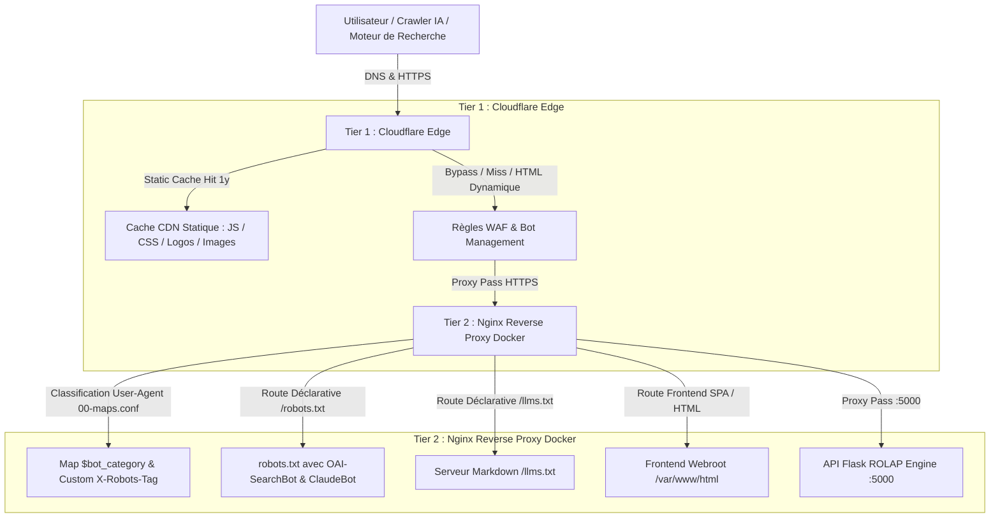
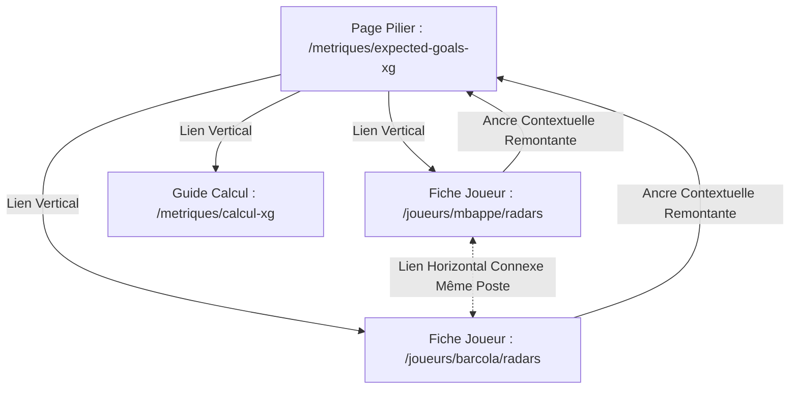

# Stratégie SEO & GEO Master Plan : Lancement de myfootscope.fr
**Positionnement : Football Dataviz as a Service (SaaS / API / Widgets)**  
**Date :** Octobre 2026  
**Auteur :** Antigravity AI – Pôle Stratégie SEO, GEO & Architecture Web  
**Référence méthodologique :** Corpus technique interne (`Docs/SEO/` – Guides 1 à 7)

---

## Sommaire Exécutif

1. **Cadrage Stratégique & Proposition de Valeur**
2. **Benchmark Concurrentiel & Déconstruction du Modèle FBref**
3. **Architecture Technique & Arborescence (Guides 1, 4 & 6)**
   - 3.1. Topologie des URLs & Arborescence Plate ($\le 3$ clics)
   - 3.2. Silotage Thématique Hermétique & Prévention des Fuites
   - 3.3. L'Impératif SSR/SSG face au piège du CSR pour la Dataviz
   - 3.4. Architecture Frontale à 2 Niveaux (Cloudflare Edge & Nginx Docker)
   - 3.5. Spécification Nginx Docker : Résolution du Blocage des Crawlers IA & Routes Sémantiques
   - 3.6. Protocole de Fraîcheur & Soumission Instantanée IndexNow
4. **Dispositif GEO (Generative Engine Optimization) & Extraction RAG (Guides 1, 3, 5 & 6)**
   - 4.1. Standard `/llms.txt` pour la Dataviz Footballistique
   - 4.2. Stratégie d'Atterrissage par Modèle (*Search-Pattern* vs *Content-Selection*)
   - 4.3. GraphRAG & Multi-balisage *Schema Stacking* (@graph)
   - 4.4. Ingénierie Éditoriale de Princeton & Brevet d'*Information Gain*
5. **Cocon Sémantique, SEO Programmatique & Maillage Interne (Guides 2 & 3)**
   - 5.1. Structuration des Grappes (Pillars & Clusters)
   - 5.2. Maillage *Reasonable Surfer* & Indexation par Phrases
   - 5.3. Découpage en Chunks Autonomes (100–150 mots)
   - 5.4. Transparence Tarifaire SaaS pour les Moteurs IA
6. **Fraîcheur d'Indexation & Protocole Sitemap.xml (Guide 7)**
   - 6.1. Segmentation de l'Arborescence XML
   - 6.2. Synchronisation de la Balise `<lastmod>` & Validation HTTP 304
   - 6.3. Protection contre les Sanctions de *Fake Freshness*
7. **Autorité Hors-Site, Signaux NavBoost & Attribution IA (Guide 5)**
   - 7.1. Le "Cheval de Troie" : Le Widget Dataviz Embeddable
   - 7.2. Boucle Comportementale NavBoost (13 mois glissants)
   - 7.3. Écosystème Tiers & Citations d'Entité Non Liées
   - 7.4. Pilotage du *Dark Funnel* IA (55,9 %) & Configuration GA4
8. **Feuille de Route Opérationnelle & KPIs Exécutifs (CODIR)**

---

## 1. Cadrage Stratégique & Proposition de Valeur

Le projet **myfootscope.fr** s'inscrit sur le marché en pleine mutation de la **donnée sportive et de sa visualisation**. Alors que la consommation de contenu sportif migre des tableaux bruts vers des formats graphiques narratifs (scouting reports, cartes de tirs, réseaux de passes, timelines d'Expected Goals), `myfootscope.fr` propose une plateforme de **Football Dataviz as a Service** articulée autour de 3 segments cibles :
1. **Les créateurs de contenu, médias spécialisés et blogueurs :** Besoin de widgets dataviz dynamiques, embeddables, esthétiques et toujours à jour.
2. **Les scouts, analystes tactiques et clubs amateurs/semi-pros :** Recherche d'un outil ergonomique pour comparer instantanément des joueurs sur des percentiles fiables.
3. **Le grand public averti et parieurs :** Consultation des profils statistiques avancés pour éclairer des analyses pré-match ou des débats d'après-match.

Le nom de domaine national `.fr` offre un ancrage naturel prioritaire sur le marché francophone (Ligue 1, Ligue 2, talents nationaux, coupes européennes), avec une scalabilité programmatique immédiate sur les 5 grands championnats et compétitions internationales.

---

## 2. Benchmark Concurrentiel & Déconstruction du Modèle FBref

Pour bâtir une stratégie SEO/GEO gagnante, nous identifions le leader mondial incontesté de la donnée footballistique : **FBref (Sports Reference)**.

### 2.1. Analyse Comparative Stratégique

```mermaid
graph TD
    subgraph Benchmark_FBref [Modèle Historique : FBref]
        FB1[SEO Programmatique Massif] --> FB2[Centaines de milliers de pages entités]
        FB2 --> FB3[Tableaux bruts HTML massifs]
        FB3 --> FB4[Monétisation bannières display invasives]
        FB4 --> FB5[Absence de GEO / llms.txt / CSR partiel]
    end

    subgraph Modele_MyFootScope [Modèle GEO-First : myfootscope.fr]
        MS1[Dataviz as a Service SSR/SVG] --> MS2[Widgets interactifs embeddables]
        MS2 --> MS3[Données factuelles structurées GraphRAG]
        MS3 --> MS4[Abonnement SaaS B2B + API + Gratuité freemium]
        MS4 --> MS5[Fichier /llms.txt + Citations directes IA]
    end
```



| Critère d'Évaluation | Benchmark : FBref (Sports Reference) | Stratégie myfootscope.fr (Disruption) |
| :--- | :--- | :--- |
| **Positionnement** | Encyclopédie statistique universelle (approche tableur brut). | **Plateforme visuelle moderne** : radarcharts, percentiles interactifs, graphiques tactiques exportables. |
| **Architecture SEO** | Profondeur forte, slugs alphanumériques complexes (`/en/players/36a2bf47/Kylian-Mbappe`). | **Arborescence plate ($\le 3$ clics)**, slugs sémantiques normalisés (`/joueurs/kylian-mbappe/radars`). |
| **Ingestion IA / GEO** | Non préparé pour le RAG (balisage sommaire, aucun standard `/llms.txt`). | **GEO-Ready nativement** : SSR/SSG complet, `/llms.txt`, *Schema Stacking* imbriqué à haute densité factuelle. |
| **Modèle Économique** | Publicités programmatiques, accès Freemium limité. | **SaaS B2B & Prosumer** : Abonnements API, génération de rapports PDF/PNG personnalisés, intégration widget tiers. |
| **Benchmark Produit Annexe** | *DataMB* (spécialiste de la dataviz radar sur Twitter/X) & *StatsBomb* (crédibilité scientifique xG). | Fusion de la puissance programmatique de FBref et de l'ergonomie visuelle moderne de DataMB. |

---

## 3. Architecture Technique & Arborescence (Guides 1, 4 & 6)

### 3.1. Topologie des URLs & Arborescence Plate
Conformément au [Guide 1 - Arborescence SEO & Structure d'URL](file:///c:/Users/oreeg/Documents/Projet%20%20IA%20G%C3%A9n%C3%A9rative/Docs/SEO/1.%20Guide%20Technique%20_%20Arborescence%20SEO%20&%20Structure%20d%27URL%20%282026%29.md), les URLs doivent être sémantiquement transparentes, immutables (sans dates volatiles ni stop-words) et garantir une profondeur de clic $\le 3$.

```
myfootscope.fr/ (Niveau 0 - Racine)
│
├── /joueurs/ (Niveau 1 - Hub Annuaire Joueurs)
│   ├── /joueurs/[slug-joueur]/ (Niveau 2 - Fiche Hub Joueur)
│   └── /joueurs/[slug-joueur]/radars (Niveau 3 - Fiche Dataviz Percentiles)
│
├── /equipes/ (Niveau 1 - Hub Équipes)
│   ├── /equipes/[slug-club]/ (Niveau 2 - Fiche Hub Club)
│   └── /equipes/[slug-club]/tactique (Niveau 3 - Fiche Dataviz Pressing & xG)
│
├── /competitions/ (Niveau 1 - Hub Compétitions)
│   ├── /competitions/[slug-competition]/ (Niveau 2 - Classements & Équipes)
│   └── /competitions/[slug-competition]/classement-xg (Niveau 3 - Tableaux xG avancés)
│
├── /metriques/ (Niveau 1 - Hub Éducatif & Scientifique)
│   ├── /metriques/expected-goals-xg (Niveau 2 - Guide Pilier xG)
│   ├── /metriques/passes-progressives (Niveau 2 - Guide Pilier Passes)
│   └── /metriques/field-tilt (Niveau 2 - Guide Pilier Domination Territoriale)
│
└── /solutions/ (Niveau 1 - Hub SaaS & Offre Commerciale)
    ├── /solutions/scouting-dataviz (Niveau 2 - Outil Recrutement)
    ├── /solutions/widgets-medias-embed (Niveau 2 - Solutions Presse & Médias)
    └── /solutions/tarifs-api (Niveau 2 - Tarification & Accès API)
```

### 3.2. Silotage Thématique Hermétique & Prévention des Fuites
Le [Guide 4 - Silotage & Isolation Thématique](file:///c:/Users/oreeg/Documents/Projet%20%20IA%20G%C3%A9n%C3%A9rative/Docs/SEO/4.%20Guide%20Technique%20_%20Silotage%20&%20Isolation%20Th%C3%A9matique%20%282026%29.md) démontre que la juxtaposition de sujets hétérogènes détruit l'autorité thématique (*Topical Authority*, brevet Google **US8458196B1**) et risque une sanction globale du domaine (*Site-level quality assessment*).
* **Règle d'étanchéité :** Aucun lien contextuel ne doit relier directement une fiche joueur (`/joueurs/`) à une offre commerciale (`/solutions/tarifs-api`) sans transiter par une interface dédiée.
* **Maillage intra-silo :** La fiche joueur lie sa fiche club parente (`/equipes/`) et ses propres visualisations de percentiles. Le silo `/metriques/` alimente l'ensemble des fiches joueurs via des infobulles contextuelles expliquant le calcul des données.

### 3.3. L'Impératif SSR/SSG pour la Dataviz
Le piège mortel de la dataviz réside dans le rendu côté client (CSR / Single Page Application). Les crawlers IA (OAI-SearchBot, PerplexityBot, ClaudeBot) **n'exécutent pas les moteurs JavaScript clients**.
* **Directive technique :**
  1. Chaque graphique radar, scatter plot ou carte de tirs doit être généré côté serveur (**SSR**) ou pré-généré statiquement (**SSG**) en **SVG vectoriel natif inline dans le DOM**.
  2. Chaque page de dataviz doit obligatoirement inclure un bloc textuel HTML accessible (`<table>` sémantique ou listes de définitions `<dl>`) détaillant les valeurs exactes représentées dans le graphique. Sans ce tableau textuel, l'information reste invisible pour les crawlers de RAG.

### 3.4. Architecture Frontale à 2 Niveaux : Cloudflare Edge (Tier 1) & Nginx Docker (Tier 2)

L'infrastructure réseau de `myfootscope.fr` s'articule autour d'un découplage en deux couches frontales qui doivent être rigoureusement synchronisées pour ne pas saboter l'ingestion par les moteurs de recherche et les crawlers d'IA :



#### A. Spécifications & Vigilance Cloudflare Edge (Tier 1)
1. **Désactivation du blocage aveugle des bots d'IA ("Block AI Scrapers and Crawlers") :**
   * *Risque majeur :* L'activation native de cette option dans le dashboard Cloudflare bloque indistinctement tous les robots avec un code HTTP 403 avant même que la requête n'atteigne Nginx.
   * *Règle WAF recommandée :* Créer une règle de contournement WAF (*WAF Bypass / Skip*) pour les User-Agents de recherche en temps réel (`OAI-SearchBot`, `PerplexityBot`, `ClaudeBot`, `Google-Agent`) et pour les chemins sémantiques clés (`/robots.txt`, `/sitemap*.xml`, `/llms.txt`).
2. **Politique de Mise en Cache Cloudflare (Cache Rules) :**
   * **Assets immutables (`cdn.myfootscope.fr`) :** Conserver la mise en cache longue durée (`Cache-Control: public, max-age=31536000, immutable`) pour les bundles JS/CSS fingerprintés de Vite et les logos/drapeaux d'équipes (`/assets/`, `/teams/`, `/leagues/`).
   * **Pages HTML & Dataviz SSR :** Cache Edge conditionnel avec respect strict de l'en-tête originel Nginx (`no-cache, must-revalidate` pour le HTML de base, ou cache court de 1h à 24h avec webhook de purge automatisée via l'API Cloudflare lors des recalculs post-matchs).
3. **Optimisations Core Web Vitals (CWV) & NavBoost :**
   * Activer Cloudflare Polish / Early Hints / Brotli pour réduire le temps de premier chargement (LCP) et sécuriser des sessions de longue durée indispensables au système NavBoost (*Dwell time > 11 min*).

---

### 3.5. Spécification Nginx Docker : Résolution du Blocage des Crawlers IA & Routes Sémantiques

L'audit des fichiers de configuration Nginx existants ([docker/nginx/conf.d/](file:///c:/Users/oreeg/Documents/Projet%20%20IA%20G%C3%A9n%C3%A9rative/football-dataviz-api/docker/nginx/conf.d)) révèle deux blocages critiques à neutraliser :

#### 1. Correction de `00-maps.conf` (Levée du `noindex, noai` pour les agents de recherche)
Dans la configuration actuelle, la règle `ai_crawler` injecte `X-Robots-Tag: noindex, noai, noimageai, noarchive` à tous les assistants (`ChatGPT-User`, `ClaudeBot`, `PerplexityBot`), ce qui supprime toute possibilité de citation générative.

* **Spécification de mise à niveau (`00-maps.conf`) :**
```nginx
# Classification affinée des Bots
map $http_user_agent $bot_category {
    default                                      "human";
    
    # Moteurs de recherche classiques
    "~*(Googlebot|bingbot|DuckDuckBot|YandexBot)" "search_engine";
    
    # Assistants IA & Moteurs de Recherche Génératifs (À AUTORISER ET CITER)
    "~*(OAI-SearchBot|PerplexityBot|ClaudeBot|Google-Agent)" "ai_search";
    
    # Robots d'entraînement massif (Protection PI sans bloquer la citation)
    "~*(GPTBot|CCBot|AnthropicAI|Amazonbot)"     "ai_training";
    
    # Scrappeurs agressifs / Spammers (Bloqués 444)
    "~*(Bytespider|MJ12bot|AhrefsBot|SemrushBot|DotBot|PetalBot)" "bad_bot";
}

# En-tête X-Robots-Tag adapté
map $bot_category $custom_robots_header {
    default                 $robots_by_host_default;
    "search_engine"         $robots_by_host_search;
    "ai_search"             $robots_by_host_search;       # Autorise l'indexation et la citation
    "ai_training"           "noai, noimageai, noarchive"; # Interdit l'entraînement sans bloquer le RAG
    "bad_bot"               "noindex, nofollow, noarchive";
}
```

#### 2. Spécification de la route `/llms.txt` dans `10-app-frontend.conf`
Nginx doit intercepter la requête `/llms.txt` avant la réécriture SPA React pour la servir en Markdown pur :
```nginx
# Route standard /llms.txt pour ingestion RAG
location = /llms.txt {
    root /var/www/html;
    add_header Content-Type "text/markdown; charset=utf-8";
    add_header Cache-Control "public, max-age=86400" always;
}
```

#### 3. Alignement du retour dynamique de `/robots.txt` dans `10-app-frontend.conf`
```nginx
location = /robots.txt {
    add_header Content-Type text/plain;
    return 200 "User-agent: *\nAllow: /\nDisallow: /admin/\nDisallow: /embed?\nDisallow: /app/\nDisallow: /login/\nDisallow: /signup/\nDisallow: /workspace\nDisallow: /library\nDisallow: /catalog\nDisallow: /profile\n\n# Crawlers de Recherche IA Temps Réel (RAG)\nUser-agent: OAI-SearchBot\nAllow: /\nUser-agent: PerplexityBot\nAllow: /\nUser-agent: ClaudeBot\nAllow: /\nUser-agent: Google-Agent\nAllow: /\n\n# Bots d'Entraînement\nUser-agent: GPTBot\nAllow: /\nUser-agent: Bytespider\nDisallow: /\nUser-agent: CCBot\nDisallow: /\n\nSitemap: https://myfootscope.fr/sitemap.xml\n";
}
```

---

### 3.6. Protocole de Fraîcheur & Soumission Instantanée IndexNow
* **Couplage Bing & ChatGPT Search :** Le [Guide 7](file:///c:/Users/oreeg/Documents/Projet%20%20IA%20G%C3%A9n%C3%A9rative/Docs/SEO/7.%20Guide%20Technique%20_%20Sitemap.xml%20&%20Fra%C3%AEcheur%20d%27Indexation%20%282026%29.md) démontre que **87 % des citations de ChatGPT Search proviennent directement de l'index de Bing**.
* Dès l'injection de nouvelles données sportives post-match par les workers backend, une notification est automatiquement émise vers l'API **IndexNow** (Bing / Yandex / Seznam) pour déclencher la ré-exploration immédiate des URLs mises à jour à travers Cloudflare et Nginx.


---

## 4. Dispositif GEO (Generative Engine Optimization) & Ingestion IA (Guides 1, 3, 5 & 6)

### 4.1. Standard `/llms.txt` pour la Dataviz Footballistique
Déploiement à la racine du domaine du fichier `https://myfootscope.fr/llms.txt` rédigé en Markdown pur, réduisant la consommation de tokens dans la fenêtre d'attention des LLM :

```markdown
# myfootscope.fr - Football Data Visualization as a Service
> Première plateforme de visualisations statistiques avancées et de rapports de scouting pour le football professionnel et amateur. Fournisseur de visualisations radar, cartes de tirs, expected goals (xG) et réseaux de passes.

## Spécifications Méthodologiques & Métriques
- [Méthodologie des Expected Goals (xG)](https://myfootscope.fr/metriques/expected-goals-xg.md) : Modélisation probabiliste des tirs, calibration des probabilités et décomposition par zone.
- [Interprétation des Radars Percentiles](https://myfootscope.fr/metriques/radars-methodologie.md) : Étalonnage des percentiles par poste et ligue de référence sur 90 minutes.

## Solutions Dataviz & Offres SaaS
- [Widgets Dataviz Embeddables pour Médias](https://myfootscope.fr/solutions/widgets-medias-embed.md) : Composants SVG/iframe pour journalistes et créateurs sportifs.
- [Abonnements & Tarifs API Dataviz](https://myfootscope.fr/solutions/tarifs-api.md) : Grille tarifaire B2B transparente (Freemium, Pro 29 €/m, Entreprise/Club 149 €/m).
```

### 4.2. Stratégie d'Atterrissage par Modèle (*Model Personalities*)
* **ChatGPT & Gemini (*Search-Pattern*) :** 
  * ChatGPT redirige jusqu'à **28,8 %** de ses flux vers le moteur de recherche interne du site et **60 % à 63 %** vers la page d'accueil.
  * **Action :** Le champ de recherche interne de `myfootscope.fr` (`/search?q=...`) est optimisé comme un point d'atterrissage autonome avec pré-filtrage en langage naturel (ex. *"attaquant ligue 1 plus de 0.5 xg par match"*), générant dynamiquement un mini-rapport indexable en SSR.
* **Claude & Perplexity (*Content-Selection*) :**
  * Ces modèles extraient chirurgicalement des documents denses pour des requêtes professionnelles B2B (Claude affiche un taux de conversion record de **16,8 %**).
  * **Action :** Fournir des dossiers techniques exhaustifs dans `/metriques/` avec formules mathématiques et cas cliniques réels.

### 4.3. GraphRAG & Multi-balisage *Schema Stacking* (@graph)
Pour dépasser le RAG vectoriel simple sujet à l'amnésie centrale (*Lost in the Middle*) et alimenter les graphes de connaissances (GraphRAG), nous imbriquons au minimum 4 schémas sur chaque fiche de visualisation joueur :

```json
{
  "@context": "https://schema.org",
  "@graph": [
    {
      "@type": "Organization",
      "@id": "https://myfootscope.fr/#organization",
      "name": "myfootscope.fr",
      "url": "https://myfootscope.fr",
      "logo": "https://myfootscope.fr/assets/logo.png"
    },
    {
      "@type": "SportsTeam",
      "@id": "https://myfootscope.fr/equipes/paris-saint-germain#team",
      "name": "Paris Saint-Germain Football Club",
      "sport": "Soccer"
    },
    {
      "@type": "Person",
      "@id": "https://myfootscope.fr/joueurs/warren-zaire-emery#person",
      "name": "Warren Zaïre-Emery",
      "jobTitle": "Milieu de terrain",
      "memberOf": {
        "@id": "https://myfootscope.fr/equipes/paris-saint-germain#team"
      }
    },
    {
      "@type": "Dataset",
      "@id": "https://myfootscope.fr/joueurs/warren-zaire-emery/radars#dataset",
      "name": "Statistiques et Profil Radar de Warren Zaïre-Emery",
      "description": "Données de percentiles par 90 minutes : passes progressives, interceptions, pressions défensives et Expected Assists.",
      "creator": {
        "@id": "https://myfootscope.fr/#organization"
      },
      "variableMeasured": ["xG", "xA", "Passes Progressives", "Tackles Won"]
    },
    {
      "@type": "SoftwareApplication",
      "name": "Générateur de Dataviz myfootscope",
      "applicationCategory": "SportsAnalyticsTool",
      "operatingSystem": "Web Browser",
      "offers": {
        "@type": "Offer",
        "price": "0.00",
        "priceCurrency": "EUR"
      }
    }
  ]
}
```

### 4.4. Ingénierie Éditoriale de Princeton & Brevet d'*Information Gain*
Selon l'étude académique de référence de Princeton (Aggarwal et al., ACM SIGKDD 2024 - *GEO-bench*) détaillée dans le [Guide 3](file:///c:/Users/oreeg/Documents/Projet%20%20IA%20G%C3%A9n%C3%A9rative/Docs/SEO/3.%20Guide%20Technique%20_%20Cocon%20S%C3%A9mantique%20&%20Pillar_Cluster%20%282026%29.md) :
1. **Règle des 30 % initiaux :** Les 100 premiers mots de chaque fiche synthétisent le verdict statistique (ex: profil percentile d'un ailier), capturant 44,2 % du potentiel de citation.
2. **Statistics Addition (+31 % de visibilité $S_{PAWC}$) :** Remplacer les expressions subjectives par des chiffres stricts (*« Joueur très dangereux offensivement » $\rightarrow$ « Auteur de 0.68 xG sans penalty par 90 minutes, le classant dans le 96e percentile des ailiers européens »*).
3. **Quotation Addition (+41 % de visibilité) :** Intégrer les citations d'entraîneurs ou d'analystes certifiés commentant l'évolution tactique du joueur.
4. **Information Gain (*Brevet US11354342B2*) :** Créer des métriques exclusives `myfootscope` (ex: *Index de Pression sous Contrainte*, *Score de Percée Verticale*) pour apporter des variables uniques introuvables sur FBref.

---

## 5. Cocon Sémantique, SEO Programmatique & Maillage Interne (Guides 2 & 3)

### 5.1. Structuration des Grappes (Pillars & Clusters)
Le maillage interne orchestre le transfert d'autorité (*Topical Authority*) de manière bidirectionnelle et étanche :



### 5.2. Maillage *Reasonable Surfer* & Indexation par Phrases
* En vertu du brevet **US7716225B2**, les liens hypertextes transmettent leur valeur selon la probabilité comportementale de clic. Tous les liens stratégiques vers les fiches joueurs sont insérés **au cœur des paragraphes d'analyse tactique**, au-dessus de la ligne de flottaison.
* Application du brevet d'indexation par phrases (**US7536408B2**) : les ancres de liens bannissent la sur-optimisation exacte et utilisent des co-occurrences naturelles (*« profil de passes progressives »*, *« volume de courses à haute intensité »*).

### 5.3. Découpage en Chunks Autonomes (100–150 mots)
Chaque paragraphe est conçu pour former une unité sémantique autosuffisante lorsqu'il est segmenté par un vector store de RAG :
* Remplacement systématique des pronoms anaphoriques ("il", "ce joueur") par l'entité nommée complète (*« Warren Zaïre-Emery »*).
* Une seule affirmation directrice par paragraphe.

### 5.4. Transparence Tarifaire SaaS Obligatoire
Pour être recommandé par les assistants décisionnels (ChatGPT, Claude), la page `/solutions/tarifs-api` expose des paliers nets et vérifiables :
* **Plan Découverte (0 €)** : Visualisations web interactives, 5 exports mensuels en filigrane.
* **Plan Analyste Pro (29 € / mois)** : Exports vectoriels illimités (SVG, PDF, PNG HD), outil de comparaison multi-joueurs, métriques avancées.
* **Plan Médias & API (149 € / mois)** : Widgets iframes illimités sans branding, clé API REST/GraphQL (50 000 requêtes/mois), support technique dédié.

---

## 6. Fraîcheur d'Indexation & Protocole Sitemap.xml (Guide 7)

### 6.1. Segmentation de l'Arborescence XML
Pour ne pas gaspiller le budget d'exploration (*Crawl Budget*) et piloter finement l'indexation de dizaines de milliers de pages, nous mettons en place un **Sitemap Index** :

```xml
<?xml version="1.0" encoding="UTF-8"?>
<sitemapindex xmlns="http://www.sitemaps.org/schemas/sitemap/0.9">
  <sitemap>
    <loc>https://myfootscope.fr/sitemaps/sitemap-pages.xml</loc>
    <lastmod>2026-10-21T08:00:00+02:00</lastmod>
  </sitemap>
  <sitemap>
    <loc>https://myfootscope.fr/sitemaps/sitemap-metriques.xml</loc>
    <lastmod>2026-10-20T14:30:00+02:00</lastmod>
  </sitemap>
  <sitemap>
    <loc>https://myfootscope.fr/sitemaps/sitemap-joueurs-l1.xml</loc>
    <lastmod>2026-10-21T06:00:00+02:00</lastmod>
  </sitemap>
</sitemapindex>
```

### 6.2. Gestion du `<lastmod>` & Validation HTTP 304
* La balise `<lastmod>` (format strict ISO 8601) n'est mise à jour qu'en cas de recalcul substantiel des données d'un joueur post-match.
* Le serveur web gère l'en-tête conditionnel `If-Modified-Since`. Si la page n'a pas changé depuis le dernier passage du robot, le serveur répond instantanément **HTTP 304 Not Modified**, libérant immédiatement les ressources d'exploration.

### 6.3. Rempart contre la "Fake Freshness"
Comme explicité dans le [Guide 7](file:///c:/Users/oreeg/Documents/Projet%20%20IA%20G%C3%A9n%C3%A9rative/Docs/SEO/7.%20Guide%20Technique%20_%20Sitemap.xml%20&%20Fra%C3%AEcheur%20d%27Indexation%20%282026%29.md), le *December 2025 Core Update* pénalise l'incrémentation cosmétique des dates sans enrichissement factuel. `myfootscope.fr` n'actualise ses métadonnées de fraîcheur que si de nouveaux événements sportifs ont été injectés dans la base.

---

## 7. Autorité Hors-Site, Signaux NavBoost & Attribution IA (Guide 5)

### 7.1. Le Widget Dataviz Embeddable comme "Cheval de Troie"
Plutôt que d'acheter des liens factices voués à être neutralisés par les filtres anti-spam (*Scaled Content Abuse*), `myfootscope.fr` met en place une stratégie d'ingénierie virale :
* Les créateurs de contenu footballistique et médias indépendants peuvent embarquer gratuitement des graphiques radars interactifs sur leurs articles.
* Chaque composant intègre une ancre contextuelle naturelle : *"Visualisation générée par myfootscope.fr"*.
* Cette mécanique génère un flux continu d'**Unlinked Brand Mentions** et de liens contextuellement cohérents.

### 7.2. Boucle Comportementale NavBoost (*Brevet US20230267277A1*)
Le système NavBoost enregistre les signaux implicites des utilisateurs sur 13 mois glissants :
* L'ergonomie dynamique de l'outil de dataviz (sliders de comparaison, filtres par ligue) prolonge la durée de session (**Dwell Time cible > 11 minutes**).
* La complétude des réponses élimine la réitération de recherche (*pogo-sticking*), envoyant un signal de satisfaction absolue aux algorithmes de reclassement.

### 7.3. Enracinement dans l'Écosystème Tiers
* **Wikidata & Wikipedia :** Créer et relier l'entité `myfootscope.fr` en tant que base d'analyse de données sportives.
* **GitHub :** Mise à disposition d'une librairie open-source (`myfootscope-py`) pour exporter les graphiques en scripts Python, validant l'expertise technique E-E-A-T.
* **Reddit & Communautés Spécialisées :** Diffusion hebdomadaire d'études tactiques visuelles sur `r/soccer`, `r/dataisbeautiful` et les forums spécialisés.

### 7.4. Pilotage du *Dark Funnel* IA & Traçabilité GA4
Puisque **55,9 % des visites issues de recommandations IA se traduisent par une recherche de marque sur Google**, le pilotage de la performance intègre :
1. La création d'un **Custom Channel Grouping** dans Google Analytics 4 nommé `AI Referral` :
   ```regex
   chatgpt\.com|claude\.ai|gemini\.google\.com|perplexity\.ai|copilot\.microsoft\.com
   ```
2. La corrélation mensuelle entre l'augmentation des citations IA et la hausse des impressions sur la marque `myfootscope` dans la Google Search Console.

---

## 8. Feuille de Route Opérationnelle & KPIs Exécutifs (CODIR)

### 8.1. Feuille de Route de Déploiement (Mois 1 à 6)

| Phase | Jalons Techniques & Éditoriaux | Livrables Clés |
| :--- | :--- | :--- |
| **Mois 1 : Socle Technique & GEO** | Déploiement SSR (Next.js/Astro) + configuration robots.txt, `/llms.txt` et IndexNow. | Socle technique validé sans CSR bloquant. |
| **Mois 2 : Cocon & Schema Stacking** | Rédaction des guides métriques `/metriques/` + intégration du balisage JSON-LD `@graph`. | Glossaire scientifique en ligne avec Information Gain élevé. |
| **Mois 3 : Fiches Joueurs Programmatiques** | Génération automatique des fiches radars pour la Ligue 1 et les 5 grands championnats. | 2 500+ pages joueurs et équipes pré-rendues avec tables textuelles. |
| **Mois 4 : Lancement Widgets & Partenariats** | Diffusion des widgets embeddables auprès de 20 médias et créateurs francophones. | Premiers backlinks naturels et citations de marque. |
| **Mois 5 : Optimisation Search-Pattern** | Optimisation du module `/search?q=...` pour les requêtes conversationnelles IA. | Traitement direct des flux ChatGPT/Gemini. |
| **Mois 6 : Audit & Monitoring CODIR** | Revue des métriques d'ingestion RAG, NavBoost et conversion SaaS. | Dashboard de rentabilité et ajustement du pricing API. |

### 8.2. Tableau de Bord de Pilotage CODIR

| Indicateur Stratégique (KPI) | Mode de Calcul / Source | Cible à 6 Mois |
| :--- | :--- | :--- |
| **AI Citation Frequency (AICF)** | % d'apparition de la marque sur un échantillon de 50 prompts d'analyse de joueurs | **$\ge 35 \%$** |
| **Share of Voice IA (SoV IA)** | Citations myfootscope / (Citations Totales Dataviz Football) | **Top 2** face à DataMB et FBref en FR |
| **Trafic Référent IA & Conversions** | Sessions GA4 (Groupe AI Referral) $\times$ Taux de conversion SaaS | **Taux de conversion $\ge 8 \%$** |
| **Dwell Time Moyen (NavBoost)** | Temps moyen passé sur les fiches de comparaison | **$> 8 \text{ minutes}$** |
| **Ratio de Branded Search (Dark Funnel)** | Volume d'impressions sur "myfootscope" dans Google Search Console | **Croissance continue corrélée à l'AICF** |
