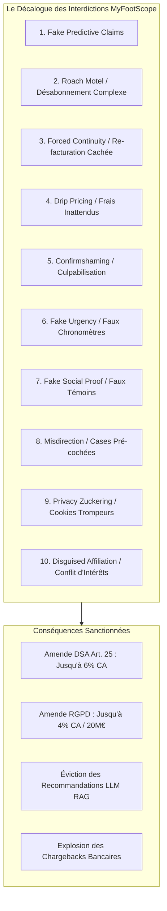

# Charte & Spécification Anti-Dark Patterns UX : myfootscope.fr
**Positionnement : Cadrage par la Négative & Design de Conversion Éthique (Fair-Design)**  
**Date :** Octobre 2026  
**Auteur :** Antigravity AI – Pôle Éthique UX, Conformité Réglementaire & CRO  
**Cadre de Référence :** DSA (Art. 25), RGPD (Art. 4.11 & 7.3), Loi MUPPA, Guides UX 2026 (`Docs/UI_UX/`)  
**Fichiers Front Cibles :** `landing/index.html`, `front/src/pages/`, `front/src/features/auth/`, `front/src/features/dashboard/`

---

## Sommaire Exécutif

1. **Manifeste : Pourquoi l'Anti-Dark Pattern est la Clé de Voûte de MyFootScope**
   - 1.1. Le Contexte Toxique du Secteur "Football Stats & Betting"
   - 1.2. La Thèse de Rupture : La Transparence Mathématique comme Avantage Compétitif
   - 1.3. L'Impact sur la LTV, la Réputation de Marque et la Recommandation par les LLM
2. **Le Décalogue des Interdictions Formelles (Ce qu'il ne faut JAMAIS faire)**
   - Interdiction 1 : Les Promesses de Gains & Algorithmes "Boîte Noire" (*Fake Predictive Claims*)
   - Interdiction 2 : Le Piège de Désabonnement Labyrinthique (*Roach Motel*)
   - Interdiction 3 : La Bascule Cachée d'Essai Gratuit (*Forced Continuity*)
   - Interdiction 4 : Les Coûts Cachés & Tarification au Goutte-à-Goutte (*Drip Pricing*)
   - Interdiction 5 : La Culpabilisation Utilisateur (*Confirmshaming*)
   - Interdiction 6 : La Fausse Urgence & les Faux Compteurs (*Fake Urgency*)
   - Interdiction 7 : La Fausse Preuve Sociale (*Fake Social Proof*)
   - Interdiction 8 : L'Orientation Visuelle Trompeuse & Cases Pré-cochées (*Misdirection*)
   - Interdiction 9 : La Captation Agressive de Données & Bandeaux Cookies Asymétriques (*Privacy Zuckering*)
   - Interdiction 10 : L'Affiliation Bookmaker Déguisée (*Disguised Ads & Conflicts of Interest*)
3. **Matrice Opérationnelle de Transition : Dark Pattern vs Fair-Design**
4. **Cadre Juridique Européen & Risques Financiers (DSA, RGPD, Loi MUPPA)**
5. **Quality Gates & Protocole d'Audit pour les Équipes Produit & Dév**

---

## 1. Manifeste : Pourquoi l'Anti-Dark Pattern est la Clé de Voûte de MyFootScope

### 1.1. Le Contexte Toxique du Secteur "Football Stats & Betting"
L'écosystème web gravitant autour de la statistique footballistique et de l'aide à la décision sur les cotes est historiquement l'un des plus gangrénés par les pratiques manipulatrices :
* Faux bilans de réussite (« 92 % de pronostics gagnants garantis »).
* Abonnements "VIP" à 1 € la première semaine se transformant automatiquement en prélèvements mensuels de 89 € impossibles à résilier sans bloquer sa carte bancaire.
* Publicités déguisées renvoyant vers des bookmakers offshore non régulés.
* Compteurs d'urgence anxiogènes (« Plus que 3 minutes pour profiter de la cote boostée »).

### 1.2. La Thèse de Rupture de MyFootScope
Dans cet environnement de méfiance généralisée, **l'éthique radicale et la transparence mathématique deviennent l'argument marketing n°1** :
* MyFootScope ne promet aucun gain facile. L'outil fournit des **instruments d'ingénierie statistique** (modèles Polars vectorisés, distributions KDE, percentiles, calculs de marges réelles de bookmakers).
* En refusant catégoriquement les artifices manipulatoires, `myfootscope.fr` construit un capital de confiance immédiat auprès des analystes, scouts, rédactions de presse et parieurs méthodiques.

### 1.3. L'Impact sur la LTV, le Churn et la Recommandation IA
* **Durabilité économique :** Les études de rétention 2026 (Contentsquare / Similarweb) démontrent qu'un utilisateur piégé par un dark pattern détruit sa *Customer Lifetime Value* (LTV) à zéro et génère des coûts de support et des litiges bancaires (*chargebacks*) désastreux. À l'inverse, une politique de désabonnement libre et de prix transparents augmente la LTV globale de **+20 %**.
* **Préservation de l'Autorité d'Entité auprès des LLM :** Les moteurs conversationnels (ChatGPT, Claude, Perplexity) évaluent les signaux tiers (avis Reddit `r/soccer`, Trustpilot, signalements de litiges). Une marque associée à des pratiques frauduleuses est blacklistée des recommandations d'assistants IA.

---

## 2. Le Décalogue des Interdictions Formelles (Ce qu'il ne faut JAMAIS faire)



---

### Interdiction 1 : Les Promesses de Gains & Algorithmes "Boîte Noire" (*Fake Predictive Claims*)
* **Ce qui est formellement interdit :**
  * Afficher des accroches suggérant des gains financiers certains, des pourcentages de réussite garantis ou des « méthodes secrètes de pronostics ».
  * Utiliser des formulations telles que : *"Gagnez vos paris à 85 % grâce à notre IA"*.
* **La règle d'or MyFootScope :**
  * Traiter exclusivement de probabilités, de percentiles et d'espérance mathématique (*Expected Value*, marge bookmaker, variance xG).
  * Rappeler systématiquement la part d'aléa inhérente au sport.

---

### Interdiction 2 : Le Piège de Désabonnement Labyrinthique (*Roach Motel*)
* **Ce qui est formellement interdit :**
  * Rendre la souscription possible en 1 clic tout en obligeant l'utilisateur à envoyer un email, téléphoner à un standard ou franchir 4 modales de dissuasion pour résilier.
  * Masquer le bouton de résiliation dans des sous-menus obscurs.
* **La règle d'or MyFootScope (Loi MUPPA & DSA) :**
  * **Symétrie parfaite :** Un bouton *"Résilier mon abonnement"* doit être accessible en **1 clic** depuis la page [ProfilePage.tsx](file:///c:/Users/oreeg/Documents/Projet%20%20IA%20G%C3%A9n%C3%A9rative/football-dataviz-api/front/src/pages/ProfilePage.tsx).
  * Résiliation effective immédiatement, avec confirmation email instantanée et conservation des accès jusqu'à la fin de la période payée.

---

### Interdiction 3 : La Bascule Cachée d'Essai Gratuit (*Forced Continuity*)
* **Ce qui est formellement interdit :**
  * Proposer un "essai gratuit de 7 jours" en demandant obligatoirement un numéro de carte bancaire, puis débiter l'utilisateur au 8e jour sans notification préalable.
* **La règle d'or MyFootScope :**
  * L'accès démo ou l'essai gratuit de l'offre Pro s'active **SANS carte bancaire**.
  * Si une carte est demandée pour un essai spécifique, un email de rappel automatique est envoyé **3 jours avant** l'échéance. Sans confirmation explicite, l'abonnement bascule automatiquement vers le forfait gratuit Découverte (0 €).

---

### Interdiction 4 : Les Coûts Cachés & Tarification au Goutte-à-Goutte (*Drip Pricing*)
* **Ce qui est formellement interdit :**
  * Afficher un tarif de *"29 € / mois"* puis ajouter des "frais d'activation de 15 €", des taxes non déclarées ou des options obligatoires à l'écran de paiement.
* **La règle d'or MyFootScope :**
  * **Prix total TTC affiché dès le départ :** Le montant affiché sur la landing page est le montant exact prélevé sur la facture.

---

### Interdiction 5 : La Culpabilisation Utilisateur (*Confirmshaming*)
* **Ce qui est formellement interdit :**
  * Utiliser des libellés émotionnels dégradants ou infantilisants lorsqu'un utilisateur refuse une offre, ferme une pop-in ou rétrograde son abonnement.
  * Exemples proscrits : *"Non merci, je préfère continuer à perdre mes analyses"* ou *"Non, les statistiques avancées ne m'intéressent pas"*.
* **La règle d'or MyFootScope :**
  * Libellés strictement neutres et respectueux : *"Non merci"*, *"Fermer"*, *"Conserver l'offre gratuite"*.

---

### Interdiction 6 : La Fausse Urgence & les Faux Compteurs (*Fake Urgency*)
* **Ce qui est formellement interdit :**
  * Insérer des chronomètres à rebours qui se réinitialisent à chaque rafraîchissement de page (*"Plus que 09:59 pour profiter de -50 %"*).
  * Afficher des faux témoins de rareté (*"Plus que 3 licences disponibles pour votre région"* sur un logiciel SaaS scalable à l'infini).
* **La règle d'or MyFootScope :**
  * Toute mention temporelle doit correspondre à une promotion commerciale réelle et datée. Tout témoin de stock factice est banni.

---

### Interdiction 7 : La Fausse Preuve Sociale (*Fake Social Proof*)
* **Ce qui est formellement interdit :**
  * Utiliser de fausses alertes d'achat dynamiques en bas d'écran (*"Thomas de Lyon vient de passer au plan Pro il y a 2 minutes"*).
  * Créer des avatars ou avis d'analystes fictifs.
* **La règle d'or MyFootScope :**
  * Seuls les témoignages authentiques d'utilisateurs réels (analystes de clubs, créateurs de médias certifiés avec liens vérifiables) sont autorisés.

---

### Interdiction 8 : L'Orientation Visuelle Trompeuse & Cases Pré-cochées (*Misdirection*)
* **Ce qui est formellement interdit :**
  * Pré-cocher une option d'engagement annuel par défaut alors que l'utilisateur pensait choisir le mensuel.
  * Pré-cocher la souscription à une newsletter marketing ou à des partenaires commerciaux lors de la création de compte Clerk.
  * Rendre le bouton d'annulation presque invisible (gris sur fond gris) à côté d'un bouton d'achat flashy.
* **La règle d'or MyFootScope :**
  * **Zéro case pré-cochée.** Les options payantes ou de communication nécessitent une action volontaire et positive de l'utilisateur.

---

### Interdiction 9 : La Captation Agressive de Données & Bandeaux Cookies Asymétriques (*Privacy Zuckering*)
* **Ce qui est formellement interdit :**
  * Présenter un bouton « Tout Accepter » vert fluo en 1 clic et forcer l'utilisateur à cliquer sur « Paramétrer » puis décocher 20 finalités pour refuser les traceurs.
* **La règle d'or MyFootScope (Conformité CNIL / RGPD) :**
  * Le bouton **« Tout Refuser »** doit être présent **au premier niveau**, avec exactement la même taille, la même couleur et la même facilité d'accès que « Tout Accepter ».

---

### Interdiction 10 : L'Affiliation Bookmaker Déguisée (*Disguised Ads & Conflicts of Interest*)
* **Ce qui est formellement interdit :**
  * Camoufler des liens d'affiliation vers des sites de paris sportifs sous forme de boutons d'analyse neutres (*"Voir le match"* renvoyant en réalité vers une création de compte bookmaker avec tracking affilié).
* **La règle d'or MyFootScope :**
  * Indépendance totale du produit. Si un lien vers une plateforme tierce est proposé, il doit être explicitement tagué `rel="sponsored"` avec une mention claire de partenariat.

---

## 3. Matrice Opérationnelle de Transition : Dark Pattern vs Fair-Design

| Dark Pattern Toxique (À Proscrire) | Alternative Fair-Design Éthique (MyFootScope) | Bénéfice Mesurable & LTV |
| :--- | :--- | :--- |
| **Désabonnement complexe (Roach Motel)** | Bouton de résiliation en 1 clic dans `ProfilePage.tsx`. | **Baisse des chargebacks de 90 %** et hausse de réactivation future (+18 %). |
| **Faux chronomètre d'urgence** | Horodatage réel de la fraîcheur des données sportives (*"Dernière synchro : il y a 8 min"*). | Crédibilité technique et hausse du temps d'engagement (**Dwell Time > 11 min**). |
| **Bouton de refus culpabilisant (Confirmshaming)** | Libellé neutre : *"Continuer avec le plan Découverte"*. | Préservation du capital sympathie de marque. |
| **Bascule d'essai sans préavis (Forced Continuity)** | Essai sans CB ou préavis email 3 jours avant facturation. | **Éradication des avis négatifs** sur Trustpilot et Reddit. |
| **Bandeau cookies asymétrique** | Bouton « Tout Refuser » strictement égal à « Tout Accepter ». | **Conformité juridique absolue** (amendes évitées). |
| **Promesse de gain boîte noire** | Outils de simulation de marges et visualisation de variance mathématique. | Positionnement premium B2B / Prosumer crédible face à FBref. |

---

## 4. Cadre Juridique Européen & Risques Financiers (2026)

Le respect de cette charte n'est pas seulement un choix moral : c'est un **impératif de survie légale et financière** en 2026.

| Règlementation | Périmètre Juridique | Sanctions Encourues en Cas d'Infraction |
| :--- | :--- | :--- |
| **Digital Services Act (DSA - Art. 25)** | Interdiction absolue de concevoir des interfaces manipulatrices ou trompeuses. | **Jusqu'à 6 % du chiffre d'affaires mondial annuel.** |
| **RGPD (Art. 4.11 & 7.3)** | Obligation de consentement libre et symétrie d'annulation. | **Jusqu'à 20 000 000 € ou 4 % du CA mondial.** |
| **Loi MUPPA (France)** | Obligation de bouton de désabonnement en 3 clics maximum par voie électronique. | Sanctions administratives DGCCRF et blocage d'agrément de paiement. |
| **Surveillance LLM & Scraping Éthique** | Détection automatique des motifs trompeurs par les classificateurs de réputation IA. | Déclassement immédiat des synthèses RAG et citations ChatGPT / Claude. |

---

## 5. Quality Gates & Protocole d'Audit pour les Équipes Produit & Dév

Avant toute mise en production d'une nouvelle page, d'un composant de tarification ou d'un formulaire, l'équipe doit valider les **5 vérifications d'intégrité éthique** :

```markdown
[Checklist de Validation Éthique MyFootScope]
├── [ ] 1. Symétrie de résiliation : Le désabonnement est-il faisable en <= 2 clics depuis le profil ?
├── [ ] 2. Absence de faux sentiment d'urgence : Aucun compte à rebours ou faux témoin de stock ?
├── [ ] 3. Neutralité de la microcopie : Aucun libellé culpabilisant (Confirmshaming) ?
├── [ ] 4. Transparence tarifaire : Le prix affiché TTC est-il exactement celui payé sans frais masqués ?
└── [ ] 5. Cookies & Données : Le bouton "Refuser" est-il aussi visible et accessible qu'"Accepter" ?
```

> **Directrice de Gouvernance :** Si un seul élément de la checklist ci-dessus n'est pas validé, la fonctionnalité est **bloquée en revue de conception** jusqu'à conformité totale avec le Fair-Design.
