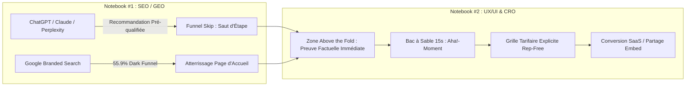
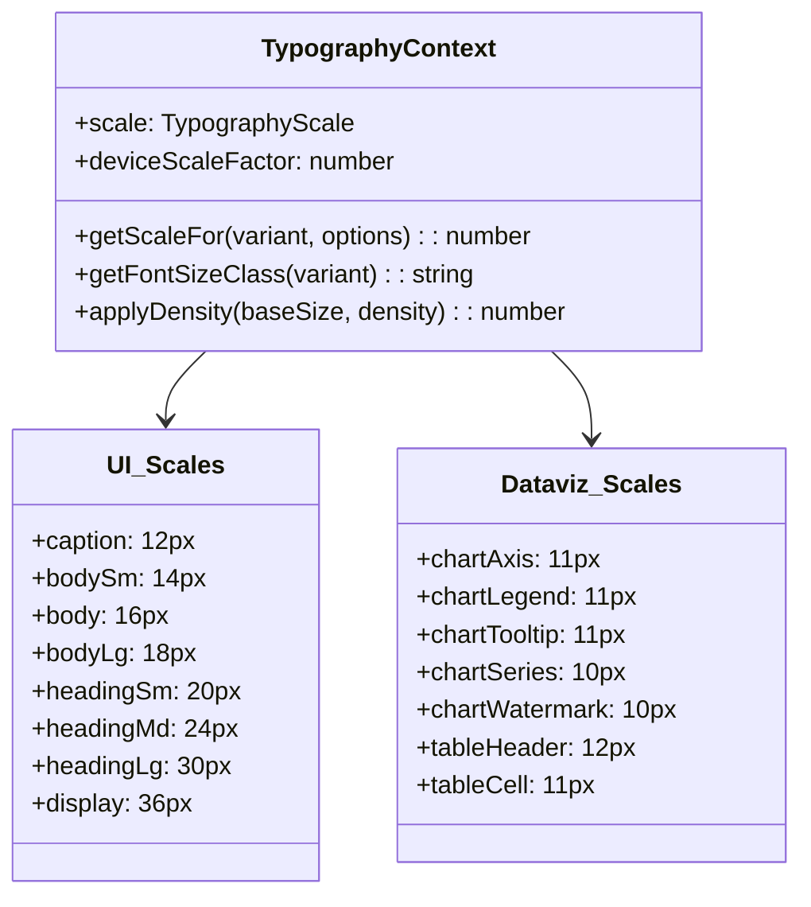
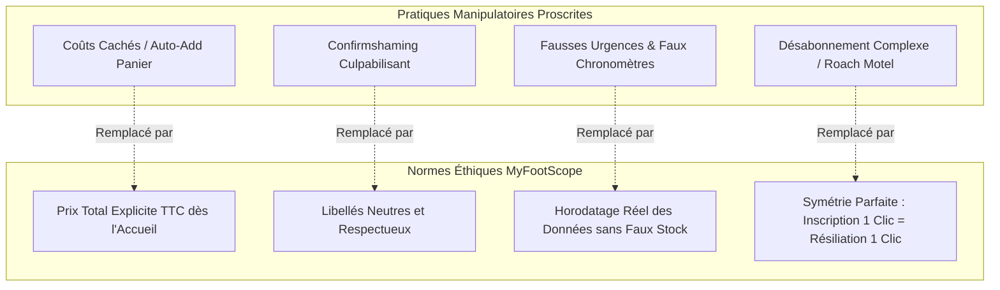

# Stratégie UX/UI & Design de Conversion 2026 : myfootscope.fr
**Positionnement : Football Dataviz as a Service (Landing Page, Workspace SPA & Conversion SXO)**  
**Date :** Octobre 2026  
**Auteur :** Antigravity AI – Pôle Design de Conversion & Expérience Utilisateur  
**Référence méthodologique :** Notebook #2 UX/UI (`Docs/UI_UX/` – Note de Cadrage, Rapport Technique LLM & Guidelines Éthiques)  
**Socle Technique Analysé :** `landing/index.html`, `front/src/routes.tsx`, `front/src/index.css`, `front/src/contexts/TypographyContext.tsx`, `front/src/pages/WorkspacePage.tsx`

---

## Sommaire Exécutif

1. **Cadrage SXO 2026 : Le Pont entre Acquisition IA & Conversion**
   - 1.1. La Microéconomie de la Conversion LLM (Taux de 5,0 % à 16,8 % & Valeur +340 %)
   - 1.2. Le Phénomène du *Funnel Skip* & le Traitement du *Dark Funnel* (55,9 %)
   - 1.3. Les 3 Profils d'Utilisateurs Cibles (Créateur Média, Scout/Club, Parieur-Analyste)
2. **Audit Analytique de l'Existant (`landing/` & `front/src/`)**
   - 2.1. Audit de la Landing Page Statique (`landing/index.html` & `style.css`)
   - 2.2. Audit du Routeur SPA (`front/src/routes.tsx`) & de la HomePage React
   - 2.3. Audit du Workspace Analytique (`front/src/pages/WorkspacePage.tsx`)
3. **Harmonisation du Design System & Système Typographique**
   - 3.1. Le Système Typographique Centralisé (`TypographyContext.tsx`)
   - 3.2. Échelles UI vs Échelles DataViz (ECharts / Arrow IPC)
   - 3.3. Facteurs de Scaling par Device & Gestion de la Densité
   - 3.4. Tokens OKLCH de `index.css` (Parchemin Feutré vs Graphite Dark Mode)
   - 3.5. Conformité WCAG 2.2 Niveau AA (Contrastes, Cibles 24x24px, Clavier)
4. **Spécification UX/UI de la Landing Page : Maximisation du Funnel Skip**
   - 4.1. Reconfiguration *Above the Fold* (Règle des 30 % & Densité Factuelle)
   - 4.2. Bac à Sable Interactif & "Aha! Moment" en moins de 15 secondes
   - 4.3. Grille Tarifaire Transparente (*Rep-Free B2B Experience*)
   - 4.4. Matrice d'UX Writing Factuel & Microcopie de Réassurance
5. **Spécification UX du Workspace & Studio Analytique**
   - 5.1. L'OmniSearch Command-K comme Surface d'Acquisition (34,6 % Trafic SaaS)
   - 5.2. Résolution du Canvas Vide via le Composant `<CanvasBeacon />`
   - 5.3. Intégration Conversationnelle de "L'Adjoint MyFootScope" (Standard W3C WebMCP)
   - 5.4. Composant de Widget Embed Exportable (Backlink Naturel & Viralité)
6. **Cadre Éthique, Zéro Dark Pattern & Conformité DSA / RGPD**
   - 6.1. Rejet Algorithmique des "Prédictions Magiques" & Transparence Mathématique
   - 6.2. Symétrie d'Intention : Inscription 1 Clic = Désabonnement 1 Clic
   - 6.3. Protection contre les Coûts Cachés et la Fausse Urgence
7. **Matrice des KPIs UX/UI & Tableau de Bord CRO**

---

## 1. Cadrage SXO 2026 : Le Pont entre Acquisition IA & Conversion

Le référencement naturel et l'optimisation pour moteurs génératifs (Notebook #1 SEO/GEO) capturent l'attention ; le design d'expérience et d'interface (**SXO - Search eXperience Optimization**) transforme cette attention en **valeur économique et fidélisation pérenne**.



### 1.1. La Microéconomie de la Conversion LLM
Les données sectorielles consolidées de 2026 (Semrush, Contentsquare, Similarweb) établissent une divergence nette entre le trafic issu de la recherche traditionnelle et celui issu des moteurs génératifs :
* **Taux de conversion moyen :** **1,3 % à 2,8 %** pour le SEO classique, contre **5,0 % à 16,8 %** pour les visiteurs acheminés par les LLM (multiplicateur de **$\times 4,4$ à $\times 9$**). Claude enregistre le taux le plus élevé du marché (**16,8 %**) sur les cibles B2B.
* **Valeur économique par visiteur unique :** **1,85 \$** pour le trafic IA contre **0,42 \$** pour la recherche classique (+340 %).
* **Maturité de session :** Les utilisateurs acheminés par recommandation IA consultent en moyenne **12 pages par visite** et passent **11,8 minutes sur le site** (contre 6,5 pages et 5,6 minutes pour le search classique).

### 1.2. Le Phénomène du *Funnel Skip* & le *Dark Funnel* (55,9 %)
1. **Le Funnel Skip :** L'utilisateur qui arrive sur `myfootscope.fr` depuis ChatGPT ou Perplexity a déjà analysé les options concurrentes (FBref, DataMB, Understat) au sein du prompt conversationnel. Il ne vient pas pour lire une promesse marketing vague, mais pour **exécuter une décision déjà cadrée**. L'interface doit court-circuiter le tunnel de découverte traditionnel et afficher la preuve opérationnelle dès les premières secondes.
2. **Le Dark Funnel (Attribution Gap de 55,9 %) :** Plus de la moitié des visiteurs influencés par une IA n'arrivent pas via un lien direct traçable `chatgpt.com`, mais ouvrent un nouvel onglet pour taper *"MyFootScope"* sur Google. La landing page principale (`/`) et le moteur de recherche interne constituent donc la surface d'atterrissage critique de ce trafic indirect.

---

## 2. Audit Analytique de l'Existant (`landing/` & `front/src/`)

### 2.1. Audit de la Landing Page Statique (`landing/index.html` & `style.css`)
* **Forces identifiées :**
  * Positionnement sain et éthique : refus explicite des "prédictions magiques" (concept section, ligne 135) au profit des mathématiques et de la transparence.
  * Mockup animé avec vidéo de démonstration du Bar Chart (`static/barchart_demo.mp4`) prouvant l'existence d'un outil fonctionnel.
  * Structure CSS soignée avec fond feutré, lueur radiale (`radial-glow`) et typographies modernes Google Fonts (*Inter* et *Outfit*).
* **Axes d'amélioration SXO & CRO 2026 :**
  1. *Absence de données chiffrées en Above the Fold :* Le H1 (*« Concevez vos propres tableaux de bord football »*) reste purement déclaratif et n'inclut aucune métrique concrète (ex: 2 500+ joueurs indexés, latence sub-25ms, 19 tables de métadonnées).
  2. *Absence totale de grille tarifaire :* La page ne présente aucun tarif public. Pour les agents de RAG et les 61 % d'acheteurs B2B exigeant une expérience sans commercial (*rep-free*), cette omission bloque la recommandation transactionnelle.
  3. *CTA unique orienté inscription sans démo en 1 clic :* Le bouton principal renvoie vers `/signup` au lieu de permettre un test immédiat de type bac à sable (*sandbox sans login*).

### 2.2. Audit du Routeur SPA (`front/src/routes.tsx`) & de la HomePage React
* Le routeur `@tanstack/react-router` structure parfaitement les routes clés :
  * `/` $\rightarrow$ `HomePage.tsx`
  * `/workspace` $\rightarrow$ `WorkspacePage.tsx` (avec garde d'authentification Clerk protégée)
  * `/explore` $\rightarrow$ `ExplorePage.tsx` (démo publique accessible)
  * `/catalog` $\rightarrow$ `DataCatalogPage.tsx`
  * `/embed` $\rightarrow$ `EmbedPage.tsx`
* **Opportunité SXO :** La route `/explore` est une arme de conversion majeure. Le composant `HomePage.tsx` dispose d'un feature flag `displayExplore` qu'il convient de placer au cœur de la stratégie d'atterrissage.

### 2.3. Audit du Workspace Analytique (`front/src/pages/WorkspacePage.tsx`)
* **Forces d'ingénierie :**
  * Souscriptions Zustand granulaires par `widgetIds` pour éliminer tout re-render sauvage lors de l'édition d'un graphique.
  * Raccourcis clavier (`useDashboardShortcuts` / `HotkeysProvider`) garantissant une fluidité de manipulation pro.
  * Passerelle agentique intégrée : le composant `<WebMcpBridge />` est déjà présent à la ligne 16, prêt à relier les outils de manipulation de widgets.
* **Point de friction UX identifié :**
  * Risque de "syndrome de la page blanche" : à la première ouverture d'un espace de travail vide, l'utilisateur fait face à une grille vierge sans guidage spatial.

---

## 3. Harmonisation du Design System & Système Typographique

Le projet dispose d'une infrastructure de Design System très avancée dans [front/src/contexts/TypographyContext.tsx](file:///c:/Users/oreeg/Documents/Projet%20%20IA%20G%C3%A9n%C3%A9rative/football-dataviz-api/front/src/contexts/TypographyContext.tsx) et [front/src/index.css](file:///c:/Users/oreeg/Documents/Projet%20%20IA%20G%C3%A9n%C3%A9rative/football-dataviz-api/front/src/index.css).

### 3.1. Le Système Typographique Centralisé (`TypographyContext.tsx`)
Le contexte gère une double échelle typographique : les composants d'interface standard et les éléments internes de DataViz (ECharts / SVG).



### 3.2. Facteurs de Scaling par Device & Densité
* **Adaptation Viewport :**
  * `mobile (< 768px)` : facteur **0.95** (préservation de l'espace sur petits écrans).
  * `tablet (768–1024px)` : facteur **1.0** (baseline).
  * `desktop (1024–1920px)` : facteur **1.1** (lisibilité confortable sur poste de travail).
  * `largeDesktop (1920–2560px)` : facteur **1.12**.
  * `ultrawide (>= 2560px)` : facteur **1.18** (dashboard plein écran sans pixellisation).
* **Règle SXO d'Intégration :** L'ensemble des widgets de dataviz et des blocs d'information de la landing page doivent obligatoirement consommer `useTypography()` ou les classes dérivées (`text-[var(--...)]`) pour garantir une harmonie typographique stricte entre la vitrine et l'application.

### 3.3. Tokens OKLCH de `index.css` (Clair Feutré & Sombre Graphite)
Le fichier `front/src/index.css` met en œuvre un modèle de couleurs haute fidélité basé sur l'espace colorimétrique **OKLCH**, garantissant une perception uniforme de la luminance :
* **Thème Clair (Parchemin & Papier) :**
  * Fond principal : `oklch(0.92 0.01 95)` (fond parchemin léger évitant le blanc pur clinique).
  * Texte : `oklch(0.24 0.01 70)`.
  * Bordures : `oklch(0.9 0.008 85)`.
* **Thème Sombre (Graphite Doux) :**
  * Fond principal : `oklch(0.205 0.003 60)` (dark grey graphite feutré évitant l'éblouissement noir OLED).
  * Texte principal : `oklch(0.89 0.002 60)` (blanc cassé chaud).
  * Cartes & Widgets : `oklch(0.245 0.004 60)` (surélévation douce d'un niveau).
* **Dataviz Accent Palette :**
  * `--chart-1` : `oklch(0.55 0.22 260)` (Bleu cobalt profond).
  * `--chart-2` : `oklch(0.70 0.17 160)` (Vert émeraude / Expected Goals).
  * `--chart-3` : `oklch(0.77 0.18 70)` (Ambre doré / Alertes cotes).

### 3.4. Conformité d'Accessibilité WCAG 2.2 Niveau AA
1. **Contraste de Texte (Critère 1.4.3) :** Tous les textes de l'interface respectent un ratio de contraste minimal de **4,5:1** contre leur fond respectif (et 3:1 pour les titres > 18pt).
2. **Zones de Ciblage Tactile (Critère 2.5.8) :** Les poignées de redimensionnement Grafana (`.react-resizable-handle-se`) intègrent une zone d'action étendue via un pseudo-élément `::before` de **36x36px**, dépassant le seuil minimal requis de 24x24px.
3. **Navigation Clavier Intégrale (Critère 2.1.1) :** Toutes les actions de la toolbar et des sélecteurs de métriques sont exécutables séquentiellement par Tabulation et raccourcis globaux.

---

## 4. Spécification UX/UI de la Landing Page : Maximisation du Funnel Skip

### 4.1. Reconfiguration *Above the Fold* (Règle des 30 %)
Pour satisfaire les exigences du *Funnel Skip* et capter les 44,2 % de potentiel de citation issus du premier tiers de page :

```html
<!-- Recommandation d'optimisation H1 & Preuve Chiffrée -->
<div class="hero-container">
    <div class="hero-badge">
        <span class="badge-dot animate-pulse"></span>
        <span class="badge-text">Workbench de Dataviz Football • Moteur Polars Vectorisé sub-25ms</span>
    </div>
    
    <h1 class="hero-title">
        La plateforme d'ingénierie statistique <br>
        <span class="text-gradient">pour le football professionnel</span>
    </h1>
    
    <!-- Micro-statistiques de preuve au-dessus du pli -->
    <div class="hero-proof-bar">
        <div class="proof-item"><strong>2 500+</strong> Joueurs cartographiés</div>
        <div class="proof-divider">•</div>
        <div class="proof-item"><strong>5 Grands Championnats</strong> & L1/L2</div>
        <div class="proof-divider">•</div>
        <div class="proof-item"><strong>0 Boîte Noire</strong> Données 100% vérifiables</div>
    </div>
    
    <div class="hero-cta-group">
        <a href="https://app.myfootscope.fr/explore" class="btn btn-primary btn-lg">
            Tester la Démo Interactive (Sans Inscription) →
        </a>
        <a href="#tarifs" class="btn btn-secondary btn-lg">
            Voir la Grille Tarifaire Transparente
        </a>
    </div>
</div>
```

### 4.2. Le Bac à Sable Interactif ("Aha! Moment" en 15 secondes)
Au lieu de renvoyer systématiquement vers un formulaire de création de compte qui freine 70 % des visiteurs, la landing page intègre un **mini-studio interactif embarqué** au sein de la section hero :
* L'utilisateur peut modifier en direct le joueur visualisé dans un widget radar (ex. basculer de *Kylian Mbappé* à *Bradley Barcola*) et observer la mise à jour instantanée des percentiles en moins de 25 ms.
* Ce contact immédiat avec la performance du moteur ROLAP matérialise la proposition de valeur technique sans aucune barrière d'accès.

### 4.3. Grille Tarifaire Transparente (*Rep-Free B2B Experience*)
Conformément au [Guide 3 SEO](file:///c:/Users/oreeg/Documents/Projet%20%20IA%20G%C3%A9n%C3%A9rative/Docs/SEO/3.%20Guide%20Technique%20_%20Cocon%20S%C3%A9mantique%20&%20Pillar_Cluster%20%282026%29.md) et aux standards d'ingestion B2B, l'insertion d'une section tarifaire claire sur la landing page est indispensable :

| Forfait / Offre | Tarif Mensuel | Fonctionnalités Clés Incluses | Profil Cible | CTA Décisionnel |
| :--- | :--- | :--- | :--- | :--- |
| **Découverte** | **0 €** / mois | Accès aux visualisations de base, 5 exports mensuels filigranés. | Passionnés & Amateurs | *Commencer Gratuitement* |
| **Analyste Pro** | **29 €** / mois | Exports illimités SVG/PNG HD, profils percentiles 360°, sauvegarde de recettes de filtrage. | Scouts, Analystes & Créateurs | *Essai Gratuit 14 Jours (Sans CB)* |
| **Médias & API** | **149 €** / mois | Widgets iframes illimités sans branding, clé API REST (50k requêtes), export Arrow IPC. | Rédactions, Clubs & Développeurs | *Déployer l'API* |

### 4.4. Matrice d'UX Writing Factuel & Microcopie
Application stricte des règles de microcopie anti-marketing :

| Emplacement | Formulation Vague (À Proscrire) | Microcopie Factuelle SXO (À Appliquer) |
| :--- | :--- | :--- |
| **Bouton CTA Principal** | *"Rejoignez la révolution de la dataviz football !"* | *"Accéder au Workspace Démo (Gratuit sans carte bancaire)"* |
| **Sous-titre Données** | *"Toutes les statistiques les plus fiables du marché."* | *"Données officielles traitées par notre kernel Polars Rust en < 25 ms."* |
| **Mention Résiliation** | *"Abonnez-vous en toute sérénité."* | *"Résiliation en 1 clic depuis votre profil à tout moment."* |

---

## 5. Spécification UX du Workspace & Studio Analytique

### 5.1. L'OmniSearch Command-K comme Surface d'Acquisition
Les données de comportement d'atterrissage confirment que **34,6 % des visiteurs SaaS issus des LLM atterrissent directement sur la recherche interne**.
* **Implémentation UX :**
  * L'OmniSearch (`⌘+K` ou `Ctrl+K`) n'est pas un simple filtre d'historique : il agit comme un **moteur de commande universel** capable d'interpréter des intentions sémantiques (ex. *"Créer radar attaquant Ligue 1 U23 xG > 0.5"*).
  * L'exécution instantanée sans latence (recherche locale en mémoire sur les 19 tables de métadonnées) valide la puissance de l'outil dès la première seconde.

### 5.2. Résolution du Canvas Vide via `<CanvasBeacon />`
Pour éradiquer le "syndrome de la page blanche" identifié lors de l'audit de `WorkspacePage.tsx` :
1. **État Initial Pré-configuré :** Tout nouvel utilisateur accédant au workspace démarre avec un tableau de bord starter composé de 2 graphiques représentatifs (un radar de percentile et un scatter de séries temporelles).
2. **Composant `<CanvasBeacon />` :** Lorsque la grille est vidée, un canevas feutré avec points d'ancrage en filigrane s'affiche au centre, proposant 3 actions immédiates :
   * `[ + Ajouter un widget radar ]`
   * `[ 📁 Charger un modèle d'équipe ]`
   * `[ 💬 Demander à L'Adjoint IA ]`

### 5.3. Intégration de "L'Adjoint MyFootScope" (Standard W3C WebMCP)
La présence du composant `<WebMcpBridge />` dans le workspace permet de matérialiser la vision agentique 2026 :
* L'utilisateur peut ouvrir un volet latéral conversationnel et demander : *"Affiche-moi la comparaison du pressing entre le PSG et Monaco sous forme de scatter plot"*.
* L'Adjoint active l'outil WebMCP correspondant (`features/ai/webmcp/tools/widgets/createOngoingStreaksScatter.ts`), configure les paramètres et instancie automatiquement le widget dans la grille `react-grid-layout`.

### 5.4. Le Widget Embed Exportable : Le Levier Viral
Chaque graphique généré dans le workspace dispose d'un bouton d'export rapide :
* **Export Image / Vectoriel :** Téléchargement direct SVG / PNG 4K.
* **Code d'Intégration Iframe / Widget :**
  ```html
  <iframe src="https://app.myfootscope.fr/embed?widgetId=radars-mbappe-2026" 
          width="600" height="450" frameborder="0" loading="lazy"></iframe>
  ```
* Le widget embarqué est servi par la route Nginx `/embed` optimisée pour le framing sécurisé ([docker/nginx/conf.d/10-app-frontend.conf:l.81](file:///c:/Users/oreeg/Documents/Projet%20%20IA%20G%C3%A9n%C3%A9rative/football-dataviz-api/docker/nginx/conf.d/10-app-frontend.conf#L81)), propageant la marque `myfootscope.fr` auprès du lectorat des blogs et médias partenaires.

---

## 6. Cadre Éthique, Zéro Dark Pattern & Conformité DSA / RGPD

Conformément au document [Docs/UI_UX/guidelines-ux-ui-dark-patterns-2026.md](file:///c:/Users/oreeg/Documents/Projet%20%20IA%20G%C3%A9n%C3%A9rative/Docs/UI_UX/guidelines-ux-ui-dark-patterns-2026.md) et à l'article 25 du Règlement Européen sur les Services Numériques (**DSA**) :



1. **Refus Algorithmique des "Gains Faciles" :**
   * Contrairement aux plateformes de pronostics opaques, `myfootscope.fr` base l'intégralité de sa valeur sur des calculs d'espérance mathématique vérifiables (marges bookmakers, calculs de variance xG). Aucun dark pattern d'incitation compulsive aux paris n'est toléré dans l'interface.
2. **Symétrie des Intentions (Souscription vs Résiliation) :**
   * L'abonnement souscrit en ligne s'annule directement depuis les paramètres du profil utilisateur (`ProfilePage.tsx`) en un clic, sans passage obligé par un formulaire de contact ou un appel téléphonique.
3. **Consentement RGPD Impartial :**
   * La bannière de cookies présente le bouton « Tout Refuser » avec une mise en valeur visuelle rigoureusement identique à celle du bouton « Tout Accepter », sans pré-cochage ni piège de couleur.

---

## 7. Matrice des KPIs UX/UI & Tableau de Bord CRO

Pour piloter la performance de l'expérience utilisateur et mesurer l'impact de la démarche SXO :

| Indicateur de Performance | Formule / Source de Données | Objectif Cible 2026 | Impact Métier |
| :--- | :--- | :--- | :--- |
| **Time to Value (TTV)** | Durée entre la première visite et la manipulation du premier graphique interactif | **$\le 15\text{ secondes}$** | Validation instantanée de la promesse (Aha! Moment) |
| **Taux de Rebond Landing Page** | % de sessions d'une seule page sans interaction | **$\le 38 \%$** | Rétention des flux entrants LLM et Google |
| **Taux d'Engagement NavBoost** | Dwell Time moyen sur les visualisations (GA4) | **$\ge 11\text{ minutes}$** | Boost algorithmique dans le système Google NavBoost |
| **Taux de Conversion Démo $\rightarrow$ Signup** | Visiteurs `/explore` créant un compte gratuit | **$\ge 12,5 \%$** | Transformation du bac à sable en leads qualifiés |
| **Taux de Churn Mensuel SaaS** | Abonnements résiliés / Total abonnés actifs | **$\le 3,2 \%$** | Fidélisation par l'ergonomie et l'absence de dark pattern |
| **Ratio de Partage Embed** | Nombre de widgets embed intégrés sur des sites tiers | **$> 150\text{ widgets actifs}$** | Acquisition organique et mentions d'entité virales |
