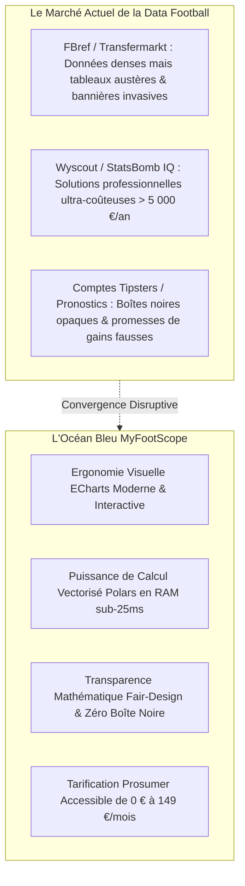
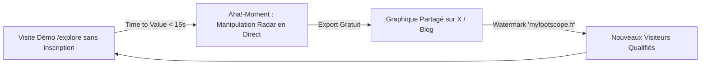
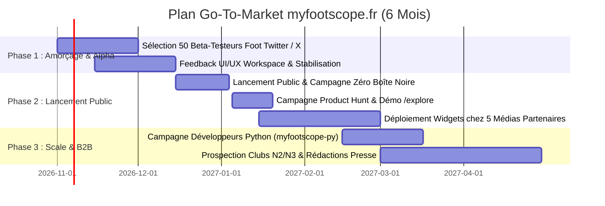

# Stratégie Marketing & Go-To-Market (GTM) 2026 : myfootscope.fr
**Positionnement : Football Dataviz as a Service (SaaS, API & Widgets Viraux)**  
**Date :** Octobre 2026  
**Auteur :** Antigravity AI – Pôle Stratégie Marketing, Product-Led Growth (PLG) & Monétisation  
**Alignement Livrables Amont :**  
- SEO & GEO : [`Strategie_SEO_GEO_myfootscope_fr.md`](./Strategie_SEO_GEO_myfootscope_fr.md)  
- UX/UI & CRO : [`Strategie_UX_UI_Conversion_2026_myfootscope.md`](./Strategie_UX_UI_Conversion_2026_myfootscope.md)  
- Éthique & Fair-Design : [`Charte_Anti_Dark_Patterns_UX_myfootscope.md`](./Charte_Anti_Dark_Patterns_UX_myfootscope.md)  

---

## Sommaire Exécutif

1. **Vision Stratégique & Brand Narrative : Le Discours de Rupture**
   - 1.1. L'Opportunité de Marché : Le Grand Écart entre Tableaux Bruts et Outils Inaccessibles
   - 1.2. La Promesse de Marque : "L'Ingénierie Statistique sans Boîte Noire"
2. **Segmentation de Marché & Cartographie des ICP (Ideal Customer Profiles)**
   - 2.1. Persona 1 : Le Créateur de Contenu & Média Indépendant (Portée & Viralité)
   - 2.2. Persona 2 : Le Scout, Analyste Tactique & Club Amateur/Semi-Pro (Monétisation SaaS Pro)
   - 2.3. Persona 3 : Le Parieur Méthodique & Data Enthusiast (Volume & Abonnement Annuel)
3. **Le Moteur d'Acquisition Product-Led Growth (PLG) : La Stratégie du "Cheval de Troie"**
   - 3.1. Le Widget Embed Interactif comme Vecteur de Croissance Virale ($K$-Factor)
   - 3.2. Le Bac à Sable Démo `/explore` : Réduction du Time-to-Value à < 15 secondes
   - 3.3. La Passerelle Open Source : Le SDK Python `myfootscope-py` pour la Communauté Data
4. **Stratégie de Contenu Éditorial & Thought Leadership (SXO + GEO)**
   - 4.1. Les Débriefs Tactiques Visuels Post-Journées de Championnat (X, LinkedIn, Reddit)
   - 4.2. La Campagne Éthique "Zéro Boîte Noire" (Démystification des Algorithmes Opaque)
   - 4.3. Les Études de Cas Métriques Éducatives (xG, Passes Progressives, Marges)
5. **Stratégie de Packaging, Pricing & Monétisation B2B/Prosumer**
   - 5.1. Matrice des 3 Forfaits Transparents (Découverte, Analyste Pro, Médias & API)
   - 5.2. Politique d'Upsell API & Modèles à l'Usage
   - 5.3. Règle du "Rep-Free Purchasing" : 100 % Souscriptible en Ligne
6. **Plan de Lancement Opérationnel Go-To-Market en 3 Phases**
   - Phase 1 (Mois 1-2) : Alpha Privée & Amorçage Communautaire (50 Beta-Testeurs Clés)
   - Phase 2 (Mois 3-4) : Lancement Public, Product Hunt & Déploiement des Widgets Pilotes
   - Phase 3 (Mois 5-6) : Scale B2B, Référencement Entreprise & Partenariats Clubs
7. **Tableau de Bord des KPIs Marketing & Modèle Économique (Unit Economics)**

---

## 1. Vision Stratégique & Brand Narrative : Le Discours de Rupture

Le marketing de `myfootscope.fr` ne vend pas du "football" : il vend de **l'autonomie d'analyse, de la crédibilité visuelle et de la clarté mathématique**.



### 1.1. L'Opportunité de Marché
Le marché mondial de la donnée sportive connaît une double fracture :
1. **D'un côté, les géants de l'analyse brute (FBref, Transfermarkt)** : Excellents pour le volume de données, mais prisonniers d'une UX vieillissante, de bannières display invasives et de visualisations statiques peu adaptées aux réseaux sociaux modernes.
2. **De l'autre, les outils institutionnels (Wyscout, StatsBomb, Opta)** : Inaccessibles financièrement aux créateurs indépendants, scouts indépendants, clubs amateurs ou parieurs avertis (licences démarrant à plusieurs milliers d'euros par an avec barrière commerciale stricte).

### 1.2. La Thèse de Marque : "L'Ingénierie Statistique sans Boîte Noire"
`myfootscope.fr` comble exactement ce fossé avec un positionnement clair :
> **« Concevez vos propres analyses. Explorez la donnée brute, créez vos visualisations sur-mesure et validez vos intuitions avec la rigueur d'un moteur vectorisé en temps réel. Sans promesse magique, sans boîte noire. »**

---

## 2. Segmentation de Marché & Cartographie des ICP (Ideal Customer Profiles)

La stratégie marketing orchestre une acquisition différenciée sur **3 personas hautement qualifiés** :

```
┌────────────────────────────────────────────────────────────────────────────────────────┐
│                        SEGMENTATION TRI-CIBLES MYFOOTSCOPE                             │
├──────────────────────────┬─────────────────────────────┬───────────────────────────────┤
│ 🎙️ 1. CRÉATEUR & MÉDIA   │ 🔍 2. SCOUT & ANALYSTE PRO  │ 📈 3. DATA BETTOR MÉTHODIQUE  │
├──────────────────────────┼─────────────────────────────┼───────────────────────────────┤
│ • Journalistes sportifs  │ • Recruteurs indépendants   │ • Parieurs quantitatifs       │
│ • Comptes Twitter/X tact.│ • Éducateurs N2/N3/R1       │ • Passionnés de modélisation  │
│ • Podcasts & YouTubeurs  │ • Analystes vidéo clubs     │ • Chercheurs de "Value Cotes" │
│ ──────────────────────── │ ─────────────────────────── │ ───────────────────────────── │
│ 🎯 Besoin : Visuels HD,  │ 🎯 Besoin : Radars percent. │ 🎯 Besoin : Marge bookmakers, │
│ graphiques interactifs,  │ sur 90 min, filtres croisés │ séries (streaks), distributions│
│ intégration iframe web.  │ d'âge/poste, export PDF.    │ de buts et variance xG.       │
│ ──────────────────────── │ ─────────────────────────── │ ───────────────────────────── │
│ 💡 Valeur : Portée &     │ 💡 Valeur : MRR SaaS élevé  │ 💡 Valeur : Rétention longue, │
│ viralité des widgets.    │ (Plan Pro 29 € ou API).     │ fidélité d'usage quotidienne. │
└──────────────────────────┴─────────────────────────────┴───────────────────────────────┘
```

### 2.1. Persona 1 : Le Créateur de Contenu & Média Indépendant
* **Pain Point :** Passe des heures sous Python (matplotlib) ou Figma pour créer un malheureux radar chart après un match, ou publie des captures d'écran illisibles de tableaux de stats.
* **Déclencheur d'Achat :** Possibilité de générer en 30 secondes un widget vectoriel interactif à ses couleurs, exportable en PNG 4K ou embeddable dans son article de blog.
* **Rôle Marketing :** **Vecteur de distribution organique**. Il diffuse gratuitement la marque auprès de son audience via le watermark cliquable du widget.

### 2.2. Persona 2 : Le Scout, Analyste Tactique & Club Amateur/Semi-Pro
* **Pain Point :** N'a pas le budget pour une licence Wyscout à 6 000 €/an, mais a besoin d'évaluer objectivement les profils de joueurs cibles selon des percentiles de ligue rigoureux.
* **Déclencheur d'Achat :** L'accès complet aux 19 tables de métadonnées, aux filtres multidimensionnels (Filter Hub) et à l'export de rapports complets de scouting.
* **Rôle Marketing :** **Cœur du chiffre d'affaires SaaS récurrent (MRR)**.

### 2.3. Persona 3 : Le Parieur Méthodique & Data Analyst
* **Pain Point :** Dégoûté des arnaques des "tipsters VIP", il recherche des indicateurs mathématiques purs (distribution des séries temporelles de victoires/défaites, espérance de buts, marge réelle appliquée par les cotes).
* **Déclencheur d'Achat :** La clarté mathématique de la plateforme et l'assurance d'un service transparent qui ne cherche pas à lui vendre un abonnement caché.
* **Rôle Marketing :** **Ambassadeur communautaire et prescripteur sur les forums spécialisés**.

---

## 3. Le Moteur d'Acquisition Product-Led Growth (PLG) : Le "Cheval de Troie"

Le modèle de croissance de `myfootscope.fr` repose sur la supériorité de son produit : c'est l'usage du produit qui alimente l'acquisition client (**Product-Led Growth**).



### 3.1. Le Widget Embed Interactif comme Moteur Viral ($K$-Factor)
* **Mécanisme :**
  * Tout utilisateur (même gratuit) peut générer un code d'intégration iframe d'un graphique (ex: radar percentile d'un joueur, scatter plot de séries).
  * Le widget est servi via la route optimisée `/embed` ([docker/nginx/conf.d/10-app-frontend.conf:l.81](file:///c:/Users/oreeg/Documents/Projet%20%20IA%20G%C3%A9n%C3%A9rative/football-dataviz-api/docker/nginx/conf.d/10-app-frontend.conf#L81)) protégée et fluide.
  * Dans le coin inférieur droit, une mention discrète et élégante indique :  
    `📊 Dataviz propulsée par myfootscope.fr`.
* **Impact Marketing :**
  * Si 50 créateurs de contenu publient chacun un widget vu par 1 000 lecteurs, cela génère **50 000 impressions qualifiées mensuelles** avec un coût d'acquisition client (CAC) de **0 €**.

### 3.2. Le Bac à Sable Démo `/explore` : Time-to-Value < 15s
* **Suppression de la friction d'activation :** Contrairement aux concurrents qui obligent à créer un compte avant de voir le moindre chiffre, `myfootscope.fr` expose sa route `/explore` directement depuis la landing page.
* En 1 clic, le visiteur manipule un tableau de bord réel, modifie un filtre et constate la réactivité sub-25ms. L'inscription n'est sollicitée que pour **sauvegarder** son travail ou exporter en haute définition.

### 3.3. La Passerelle Développeurs & Data Scientists (`myfootscope-py`)
* Publication sur GitHub et PyPI d'un package Python open-source léger permettant de requêter les données publiques et d'exporter les schémas ECharts.
* Cette initiative installe `myfootscope.fr` comme la référence technique auprès des data scientists du sport, générant des backlinks d'autorité et des mentions non liées (*Unlinked Brand Mentions*).

---

## 4. Stratégie de Contenu Éditorial & Thought Leadership

Pour asseoir la légitimité de la marque sans budget publicitaire massif :

### 4.1. Les Débriefs Tactiques Post-Journée ("Data Storytelling")
* **Format hebdomadaire :** Chaque lundi matin, publication d'un thread sur Twitter/X et d'un article court sur le blog dédié (`blog.myfootscope.fr`) analysant une anomalie statistique du week-end :
  * *Exemple :* « Pourquoi la victoire 2-0 de Lyon contre Marseille est un mirage statistique (Analyse des xG et du réseau de passes sous pression) ».
* **Asset visuel :** Graphiques exclusifs générés depuis le Workspace MyFootScope, aux couleurs de la marque, taguant les clubs et joueurs concernés.

### 4.2. La Campagne Éthique "Zéro Boîte Noire"
* Exploiter la [Charte Anti-Dark Patterns](./Charte_Anti_Dark_Patterns_UX_myfootscope.md) comme un manifeste public.
* Publier des articles de décryptage expliquant comment les algorithmes de pronostics trompent les utilisateurs et comment les calculs de variance permettent d'analyser sainement un match.
* **Effet de halo :** Les passionnés de data et les prescripteurs recommandent MyFootScope comme le seul acteur intègre du secteur.

### 4.3. Cocon Sémantique Éducatif (SXO)
* Comme spécifié dans le document [SEO/GEO](./Strategie_SEO_GEO_myfootscope_fr.md), enrichir le silo `/metriques/` d'articles de référence :
  * *« Comment interpréter un radar de percentiles par poste ? »*
  * *« Différence entre xG et Non-Penalty xG »*
* Ces articles captent les requêtes informationnelles sur Google et servent de sources de citation privilégiées pour ChatGPT et Claude.

---

## 5. Stratégie de Packaging, Pricing & Monétisation

La grille tarifaire s'aligne rigoureusement sur les standards d'ingestion des LLM et la transparence Fair-Design :

```
┌────────────────────────────────────────────────────────────────────────────────────────┐
│                         GRILLE TARIFAIRE TRANSPARENTE 2026                             │
├──────────────────────────┬─────────────────────────────┬───────────────────────────────┤
│ 🆓 FORFAIT DÉCOUVERTE    │ ⚡ FORFAIT ANALYSTE PRO     │ 🏢 FORFAIT MÉDIAS & API       │
│ 0 € / mois               │ 29 € / mois (ou 290 €/an)   │ 149 € / mois (ou 1 490 €/an)  │
├──────────────────────────┼─────────────────────────────┼───────────────────────────────┤
│ • Accès démo complet     │ • Workspace illimité        │ • Tous les avantages Pro      │
│ • Visualisations web     │ • Exports vectoriels SVG/PNG│ • Clé API REST (50k req/mois) │
│ • 5 exports mensuels     │ • Comparaison multi-joueurs │ • Widgets sans filigrane      │
│   avec filigrane         │ • Métriques avancées        │ • Débit binaire Arrow IPC     │
│ • Filtres de base        │ • Sauvegarde de recettes    │ • Support technique dédié     │
├──────────────────────────┼─────────────────────────────┼───────────────────────────────┤
│ 👉 CTA : Commencer Grat. │ 👉 CTA : Essai 14j Sans CB  │ 👉 CTA : Déployer l'API       │
└──────────────────────────┴─────────────────────────────┴───────────────────────────────┘
```

### 5.1. Règle du "Rep-Free Purchasing"
* **Zéro friction commerciale :** L'acheteur B2B ou le créateur de contenu peut souscrire directement en ligne en quelques clics via l'infrastructure de paiement Stripe / Clerk.
* Les tarifs sont indexables par les moteurs d'IA, garantissant la citation de `myfootscope.fr` dans les comparatifs tarifaires générés par ChatGPT et Claude.

### 5.2. Engagement Annuel Éthique
* L'abonnement annuel offre **2 mois gratuits** (ex: 290 €/an au lieu de 348 €), mais ne comporte aucune reconduction cachée : l'utilisateur reçoit une alerte par email 7 jours avant le renouvellement.

---

## 6. Plan de Lancement Opérationnel Go-To-Market en 3 Phases



### Phase 1 : Alpha Privée & Amorçage Communautaire (Mois 1 à 2)
1. **Recrutement des 50 Pionniers :** Identifier 50 créateurs et analystes actifs sur Twitter/X (#FootData, #TactiqueL1) et leur offrir un accès Pro à vie en échange de retours d'usage réguliers.
2. **Co-création :** Valider l'ergonomie de l'OmniSearch et du Filter Hub sur des cas d'usage réels de match.

### Phase 2 : Lancement Public & Campagne "Zéro Boîte Noire" (Mois 3 à 4)
1. **Lancement sur Product Hunt :** Présentation sous l'angle *"The Bloomberg Terminal for Football Data Visualization"*.
2. **Diffusion des Widgets Partenaires :** Intégration de widgets graphiques personnalisés sur 5 médias web francophones (ex: blogs spécialisés Ligue 1) pour créer les premiers flux viraux.
3. **Publication du Manifeste Fair-Design :** Tribune sur l'éthique de la donnée sportive, partagée sur LinkedIn et Reddit.

### Phase 3 : Scale B2B & Expansion API (Mois 5 à 6)
1. **Offre Clubs Amateurs & Semi-Pros :** Démarchage des cellules de recrutement de National 1, National 2 et centres de formation avec une offre d'essai dédiée.
2. **Documentation Développeurs :** Publication du catalogue d'API et tutoriels d'intégration pour les applications tierces.

---

## 7. Tableau de Bord des KPIs Marketing & Modèle Économique

Pour piloter la rentabilité de la stratégie Go-To-Market :

| Métrique Marketing | Mode de Calcul | Cible à 6 Mois | Rôle Stratégique |
| :--- | :--- | :--- | :--- |
| **Visiteurs Uniques Mensuels (MAU)** | Sessions uniques sur le domaine | **$\ge 25\text{ 000}$** | Taille de l'entonnoir d'acquisition |
| **Taux d'Activation Démo (`/explore`)** | % de visiteurs testant au moins 1 widget | **$\ge 45 \%$** | Validation de la valeur immédiate |
| **Conversion Démo $\rightarrow$ Compte Gratuit** | Nouveaux comptes / Visiteurs `/explore` | **$\ge 12,5 \%$** | Efficacité de l'onboarding |
| **Conversion Gratuit $\rightarrow$ Forfait Pro (SaaS)**| Abonnés payants / Total comptes actifs | **$\ge 4,8 \%$** | Monétisation du socle communautaire |
| **Widgets Embed Actifs sur le Web** | Iframes déployées sur des domaines tiers | **$\ge 150$** | Moteur de croissance virale ($K$-Factor) |
| **Revenu Mensuel Récurrent (MRR)** | Abonnements Pro + API B2B actifs | **$\ge 4\text{ 500 €}$** | Validation du modèle économique |
| **Taux d'Attrition Mensuel (Churn)** | Désabonnements / Total abonnés actifs | **$\le 3,2 \%$** | Fidélisation par l'expérience Fair-Design |
